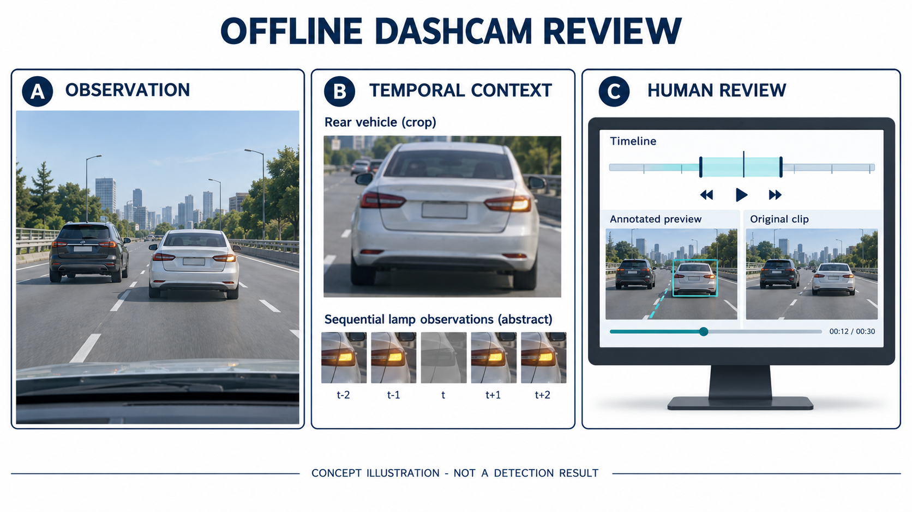
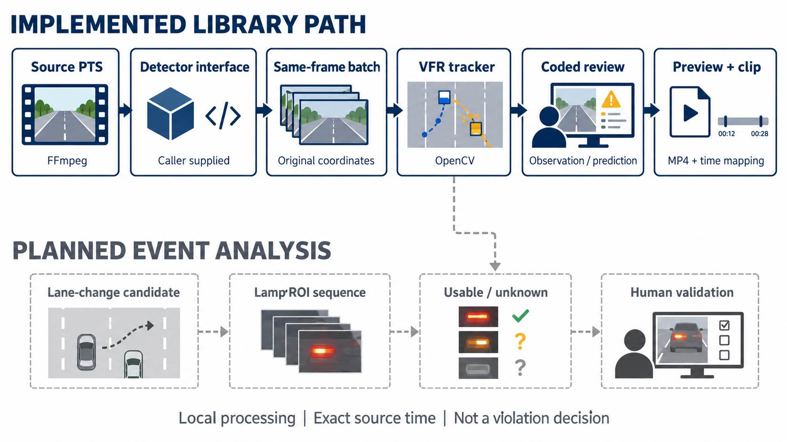
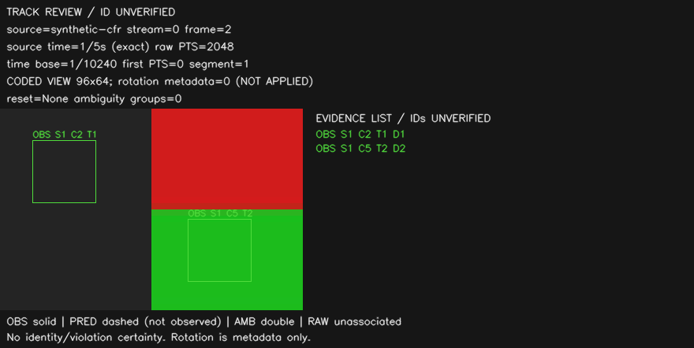
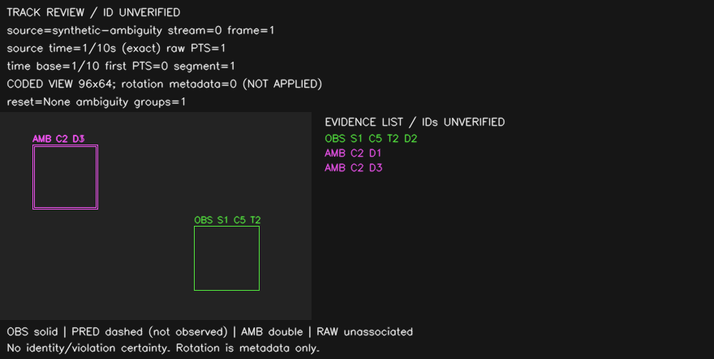
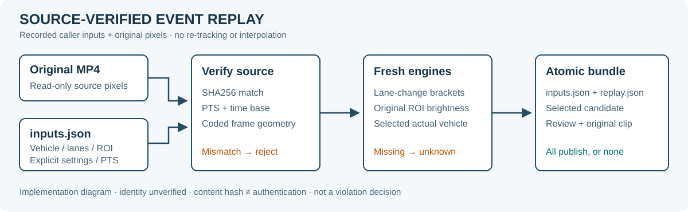
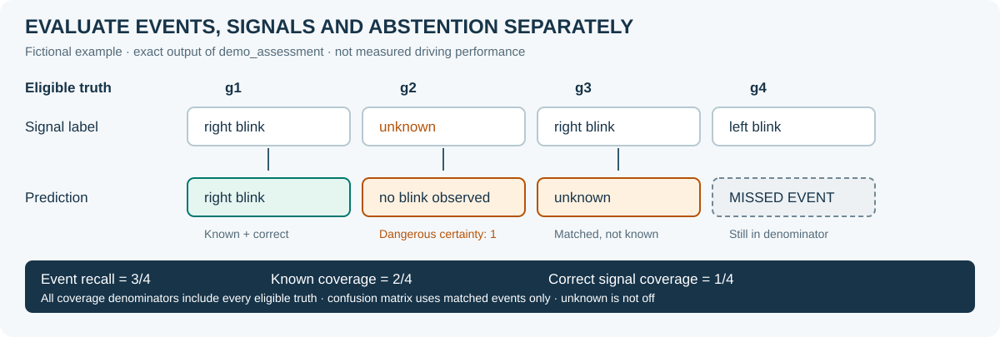
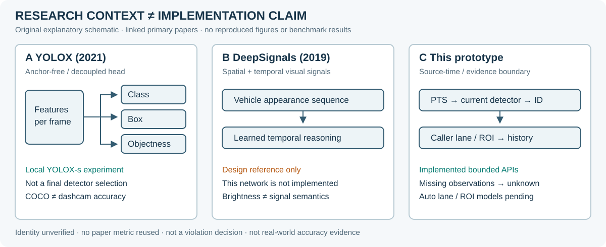

# cheating-racer-detect

### Source-Time-Preserving Dashcam Review

원본 시각과 관측 근거를 보존하는 블랙박스 분석·검토 연구 프로토타입.

## Abstract

이 프로젝트는 긴 주행 영상에서 차선 변경과 방향지시등 관측을 연결해 사람이 검토할 구간을 찾는 것을 목표로 합니다. 핵심은 같은 차량의 연속 관측, 정확한 원본 시각, 관측 불능의 구분입니다. Windows 클립 CLI, 모델 독립 탐지·추적·검토 라이브러리와 입력 주입형 차선 후보·램프 시계열·후보 클립 연결을 제공합니다. 자동 모델 기반 사건 판정과 실영상 정확도는 아직 미검증입니다.

**Keywords** — dashcam · variable frame rate · multi-object tracking · temporal observation · human review



*Figure 1. 목표 흐름의 AI 생성 개념 그림. 실제 주행 영상·탐지 결과·구현된 GUI가 아닙니다. 램프·타임라인은 설명용입니다.*

## 1. Problem and Scope

목표 흐름은 `영상 → 차량·차선 이력 → 변경 후보 → 램프 시계열 → 사람의 검토 → 클립 저장`입니다. 첫 평가 대상은 주간·맑음·전방 카메라에서 앞/대각선 앞 차량의 후면이 보이는 장면입니다. 야간·악천후를 영구 제외한다는 뜻은 아닙니다.

| 구분 | 현재 범위 |
| --- | --- |
| CLI | `doctor`, 구간 `clip`, `events list/replay/verify-list/verify/evaluate` |
| 분석 API | 같은 프레임의 탐지 계약·가변 dt 추적·관측/예측/모호성 요약·렌더링 |
| 검토 내보내기 | 무음 coded-view MP4·원본 클립의 음성/회전·프레임별 시각 매핑 |
| 사건 API | 주입 차선/자차 상태 기반 후보·좌우 ROI 시계열·단일/명시 선택 일괄 검토 클립 |
| 검증·평가 | 저장 batch 읽기 전용 재검사·이벤트 매칭·신호 confusion/unknown/미탐 포함 coverage |
| 후속 연구 | 자동 차선·자차 이동·램프 ROI/의미 인식·실영상 교정 |

미검출을 미점등으로 해석하지 않습니다. ID는 임시 추적 식별자이지 신원 정보가 아닙니다. 모델 점수·위치 예측은 위반 확률이나 실제 점멸 관측이 아닙니다.

## 2. System Overview



*Figure 2. AI 생성 구조도: 선행 라이브러리와 목표 자동 분석의 관계입니다. 탐지기는 호출자가 제공하며 점선의 자동 차선/램프 모델은 미구현입니다. 추가된 입력 주입형 사건 API는 §3.5에서 구분합니다. 화면 아이콘·예시 시각은 측정 결과가 아닙니다.*

| 기술 | 역할 | 상태 |
| --- | --- | --- |
| Python | CLI·계약·작업 제어·원본/파생 결과 기록 | 구현 |
| FFmpeg / ffprobe | 컨테이너·PTS·디코딩·H.264/AAC 클립·검토 MP4 | 구현·합성 미디어 검증 |
| NumPy / OpenCV | 가변 dt 운동 모델·관측 연결·coded 오버레이 | 선택 의존성·native 검증 |
| PyTorch / YOLOX-s | 차량 탐지 추론 후보 | 로컬 실험, 최종 모델 미정 |
| 차선·램프 모델 | 차선 경계·동일 차량 ROI·신호 의미 | 후보 비교·자동 모델 미구현/미채택 |
| Python 사건 엔진 | 차선 상대 위치·밝기 hysteresis·시간 이력·일대일 평가 | 입력 주입형 구현·합성 검증 |

YOLOX는 anchor-free 탐지와 decoupled head를 제안합니다. YOLOX-s를 후보로 실험했지만 논문의 COCO 결과를 이 프로젝트의 주행 성능으로 전용하지 않습니다. [Ge et al., 2021](https://arxiv.org/abs/2107.08430)

### 2.1 Automatic lane candidates

차선 모델은 프레임별 경계 위치를 제공합니다. 차량의 차선 변경 사건, 물리 경계의 연속 ID, 자차 이동·합류 판단은 별도입니다. 후보 비교는 2026-10-14, UFLDv2 설치 사전 점검은 2026-10-18 원저자 자료 기준입니다. 아래 모델은 **모두 미채택이며 학습 가중치의 이 PC 실행·실영상 성능은 미검증**입니다.

| 후보 | 방식·비교 목적 | 실행·연결 조건 |
| --- | --- | --- |
| [UFLDv2 · ResNet-18](https://github.com/cfzd/Ultra-Fast-Lane-Detection-v2) | row/column hybrid anchors·존재 분류; 최소 추론 구조 실험 | 난수 CPU/GPU 구조 검증·좌표 후처리 API 구현. 학습 checkpoint의 조건/로딩·실차 성능 미검증, 원본 DALI 경로 자동 설치 미지원 |
| [CLRNet · ResNet-18](https://github.com/Turoad/CLRNet) | cross-layer refinement; 같은 입력에서 위치 정밀화 대안 | 공식 시험은 Ubuntu·Python3.8/Torch1.6/CUDA10.2. CUDA NMS와 현재 Windows 환경의 호환성 미확인 |
| [CLRerNet · DLA-34](https://github.com/hirotomusiker/CLRerNet) | LaneIoU 기반 assignment/loss; 위치와 confidence 관계 비교 | mmdetection3.3·별도 CUDA NMS·Docker 권고. 점수가 차선 안정성이나 위반 확률은 아님 |

후속 제안은 **UFLDv2의 격리 추론 분리**, 대안은 CLRNet·CLRerNet입니다. Windows 지원·속도/정확도 순위가 아닙니다. 코드 표기는 각각 [MIT](https://raw.githubusercontent.com/cfzd/Ultra-Fast-Lane-Detection-v2/master/LICENSE), [Apache-2.0](https://raw.githubusercontent.com/Turoad/CLRNet/main/LICENSE), [Apache-2.0](https://raw.githubusercontent.com/hirotomusiker/CLRerNet/main/LICENSE)이며, CLRNet의 [설치 metadata](https://raw.githubusercontent.com/Turoad/CLRNet/main/setup.py)는 MIT classifier로 불일치합니다. 가중치·학습 데이터 조건은 코드와 별도로 확인해야 합니다. 특히 [CULane 조건](https://xingangpan.github.io/projects/CULane.html#license)은 데이터/파생물의 비상업 용도와 재배포 조건을 구분합니다. 프로젝트 라이선스나 배포 모델을 이 표로 확정하지 않습니다.

#### UFLDv2 installation preflight

점검 소스는 원저자 revision [`c903880`](https://github.com/cfzd/Ultra-Fast-Lane-Detection-v2/tree/c903880678454dfd9b55a63022368db05c00bc6d)입니다. 정적 소스 확인 결과이며 모델 설치·가중치 다운로드·로드/추론을 수행한 결과가 아닙니다.

| 항목 | 확인 결과·실행 전 조건 |
| --- | --- |
| 의존성 | [model](https://github.com/cfzd/Ultra-Fast-Lane-Detection-v2/blob/c903880678454dfd9b55a63022368db05c00bc6d/model/model_culane.py)과 aux module 모두 `utils.common → data.dali_data → DALI/my_interp`로 연결됩니다. demo만 우회해서는 분리되지 않습니다. [DALI 공식 지원](https://docs.nvidia.com/deeplearning/dali/user-guide/docs/support_matrix.html)은 Linux 플랫폼이며 native Windows 준비 증거가 아닙니다. |
| 생성·로딩 | 기본 factory는 `pretrained=True`·CUDA를 사용합니다. 분리안에는 backbone 다운로드 비활성화·명시 device·승인된 로컬 full checkpoint의 `weights_only=True`/CPU 로드·키/shape 대조·strict 로딩이 필요합니다. [backbone 소스](https://github.com/cfzd/Ultra-Fast-Lane-Detection-v2/blob/c903880678454dfd9b55a63022368db05c00bc6d/model/backbone.py), [PyTorch 로딩 문서](https://docs.pytorch.org/docs/2.8/generated/torch.load.html) |
| 환경·권리 | 기존 Torch/TorchVision 환경의 존재가 UFLDv2 호환성 증거는 아닙니다. wheel의 CUDA runtime과 extension용 toolkit/compiler는 별도입니다. [공식 model zoo](https://github.com/cfzd/Ultra-Fast-Lane-Detection-v2/blob/c903880678454dfd9b55a63022368db05c00bc6d/README.md)의 CULane ResNet18을 식별했지만 실제 파일 해시·적용 권리·학습 원자료 조건은 미확정입니다. |

**학습 utility를 제거한 ResNet-18 구조**는 난수 가중치로 CPU/GPU 합성 forward를 확인했습니다. 학습 가중치를 적용한 탐지 결과가 아니며 정확한 checkpoint 조건·실제 로딩과 실차 평가는 남아 있습니다. 원본 requirements 일괄 설치나 WSL/새 CUDA 환경 전환을 채택한 것은 아닙니다.

#### UFLDv2 checkpoint acquisition

2026-10-28 확인 기준, 실험 대상은 공식 model zoo의 **CULane / ResNet18**입니다. [Google Drive](https://drive.google.com/file/d/1oEjJraFr-3lxhX_OXduAGFWalWa6Xh3W/view?usp=sharing)와 [Baidu](https://pan.baidu.com/s/1Z3W4y3eA9xrXJ51-voK4WQ?pwd=pdzs)가 배포 경로이며, Drive 미리보기 제목은 `culane_res18.pth`입니다. 제목·논문 benchmark는 실제 파일의 내용·무결성이나 이 프로젝트의 성능을 증명하지 않습니다.

| 조건 | 확인된 범위 |
| --- | --- |
| 코드 | 고정 revision의 [MIT LICENSE](https://github.com/cfzd/Ultra-Fast-Lane-Detection-v2/blob/c903880678454dfd9b55a63022368db05c00bc6d/LICENSE). 외부 checkpoint의 허가 범위를 코드 표기만으로 확정하지 않습니다. |
| 학습 데이터·파생물 | [CULane 공식 조건](https://xingangpan.github.io/projects/CULane.html#license)은 학술/비학술 주체의 비상업 연구·개인 실험을 허용하고 출처 인용을 요구합니다. 원본/수정 데이터 재배포는 제한하며, 복원이 불가능한 학습 모델 등의 파생물 배포를 조건부 허용합니다. 데이터와 파생물의 상업 목적 사용은 허용하지 않습니다. |
| 실제 배포 파일 | 검토한 자료만으로 파일별 추가 조건·발행자 checksum·정확한 학습 이력은 확정하지 못했습니다. 예정 용도와 checkpoint/backbone의 적용 조건 확인이 필요합니다. 상업 사용은 별도 허가나 대체 모델/데이터 검토가 필요합니다. |

확보·검증 순서는 다음과 같습니다.

1. 비상업 연구/상업 사용 목적과 정확한 파일의 조건을 확인한 뒤 공식 배포 경로에서 확보합니다. ResNet34·다른 dataset·v1·변환 mirror를 동일 파일로 대체하지 않습니다.
2. 원본 URL·소스 revision·확보일·파일명·크기·`Get-FileHash -Algorithm SHA256 -LiteralPath <파일>` 결과를 기록합니다. 직접 계산한 해시는 이후 변경 탐지용이며 발행자 인증을 대신하지 않습니다.
3. 제한된 CPU 로딩(`weights_only=True`, `map_location="cpu"`) 후 실제 래퍼·키·shape·dtype·유한값을 확인하고 strict 로딩합니다. [공식 저장 함수](https://github.com/cfzd/Ultra-Fast-Lane-Detection-v2/blob/c903880678454dfd9b55a63022368db05c00bc6d/utils/common.py#L101-L108)는 `model`/`optimizer` 래퍼를 만들지만 실제 배포 파일은 미검사입니다. 격리 실험용 로더는 이 래퍼를 거부하므로 실제 파일 확보 뒤 호환성 검토가 필요합니다. `weights_only=False`나 `strict=False`로 우회하지 않습니다.
4. 학습 가중치의 CPU/GPU 합성 forward와 동일 원본 프레임의 좌표 연결을 검증한 뒤 실영상 평가로 진행합니다. 현재는 가중치 다운로드·로드 전 단계입니다.

연결 흐름은 `모델 곡선 → 원본 coded 좌표 → 실제 차량 하단 y의 가시 경계 → 외부 물리 ID/자차·장면 게이트 → LaneSection`입니다. 현재 계약에는 인접 두 차선을 표현할 경계가 최소 3개 필요합니다. 경계 부족·y 범위 밖·합류/ID 불확실성을 외삽해 채우지 않으며, ego/후면 자세를 확인하지 못하면 사건을 보류합니다. 좌표 decoder와 외부 조건 기반 단면 adapter는 구현됐지만, 조건 자체의 자동 인식은 미구현입니다. 모델별 전처리를 차량 탐지용 640×640 letterbox와 혼동하지 않습니다. [입력 계약](cheating_racer_detect/events/contracts.py)

UFLDv2의 [고정 config](https://github.com/cfzd/Ultra-Fast-Lane-Detection-v2/blob/c903880678454dfd9b55a63022368db05c00bc6d/configs/culane_res18.py)는 입력 1600×320·crop ratio 0.6·4 lane slots를 사용합니다. [demo](https://github.com/cfzd/Ultra-Fast-Lane-Detection-v2/blob/c903880678454dfd9b55a63022368db05c00bc6d/demo.py)와 [dataset](https://github.com/cfzd/Ultra-Fast-Lane-Detection-v2/blob/c903880678454dfd9b55a63022368db05c00bc6d/data/dataset.py)은 RGB resize 1600×533 뒤 아래 320행 crop을 구성합니다. decoder가 공급한 원본 W/H로 이미 복원한 점에는 crop/scale 역변환을 다시 적용하지 않습니다. row/column 표현·유효 slot을 보존해야 하며, 빠진 차선을 생략한 반환 list index를 물리 경계 ID로 쓰지 않습니다.

고정 dataset 크기·30fps writer 대신 현재 원본 `Frame`·PTS를 유지합니다. 모델용 확대 입력은 원본 픽셀 증거나 현재 분석 축≤1024 지원 한계를 늘리지 않습니다. RGB/crop·slot 소실·좌표 회전은 합성 검증 대상이며, 실차 가림/자차 이동과 학습 가중치 평가는 미검증입니다.

#### Frame-bound lane decoding

[`decode_ufld`](cheating_racer_detect/analysis/lanes.py)는 **추론이 아닌 출력 후처리**입니다. 고정 CULane/ResNet-18 batch1의 CPU NumPy float32/64 logits 네 개를 받아 정확한 동일 `Frame`을 확인하고, row slots 1/2와 column slots 0/3·raw existence mask를 유지한 immutable 결과를 반환합니다. 기본 패키지 import에는 ML 의존성이 없고 계산할 때만 NumPy가 필요합니다.

```python
from cheating_racer_detect.analysis import UFLDOutput, decode_ufld

# frame / cpu_numpy_logits는 호출자가 같은 프레임에서 제공해야 합니다.
output = UFLDOutput(frame, "caller-model-v1", rotation_cw=0, logits=cpu_numpy_logits)
lanes = decode_ufld(frame, output)
```

local-width 1의 ordinal expectation을 원본 view 비율로 복원하고, **실제 전처리에서 적용한 clockwise 회전**만 1회 역변환합니다. `rotation_cw=0`은 coded 입력이며 source display rotation을 자동 적용하지 않습니다. demo의 정수 truncation 대신 연속 좌표를 보존하며, grid 끝의 범위 초과·존재하지 않는 anchor는 clamp/외삽하지 않고 `None`으로 남깁니다. 슬롯이 사라져도 네 슬롯의 번호·mask·sample 위치는 유지됩니다.

anchor-count support는 포맷 조건이지 실제 가시성·신뢰도·물리 경계 ID가 아닙니다. decoder 자체는 `LaneSection`이나 변경 사건을 만들지 않습니다. 차량 하단 y 단면과 명시적 외부 조건 연결은 아래 API로 구분합니다. [숫자·회전·누락·실패 시험](tests/test_lane_decoder.py), [실제 합성 CFR/VFR/offset/회전 PTS 연결 시험](tests/test_lane_decoder_native.py)

#### Visibility-constrained lane sections

[`section_for_vehicle`](cheating_racer_detect/events/sections.py)는 동일 `Frame`의 실제 `Vehicle` bbox 하단 `y2`에서 차선 곡선을 단면화합니다. 호출자가 **연속된 물리 경계의 좌→우 순서/ID**, 각 인접 anchor **구간 전체의 가시성**, coded 축 해석·자차 안정·일반 도로·후면 자세를 명시해야 합니다. 존재 마스크를 가시성으로 바꾸거나 모델 슬롯을 물리 ID로 자동 승격하지 않습니다. 조건은 caller 선언이며 실제 정확성·타이어 접점·ID 안정성의 인증이 아닙니다.

가시성이 명시된 인접 두 sample 안에서만 선형 보간합니다. `None`을 건너뛰거나 지원 범위 밖으로 외삽하지 않으며, 수평 중첩·다중 교차·경계 순서 역전·가시 경계 부족은 `section=None`과 이유로 반환합니다. 필요한 경계를 버린 뒤 남은 곡선을 정렬해 새로운 인접 관계를 만들지 않습니다. 정상 결과도 원본 PTS와 사용 anchor bracket/보간 비율을 보존합니다.

```python
from cheating_racer_detect.events import LaneSectionBridge

# lane_config는 명시 정책, context는 해당 Frame/차량/모델의 외부 확인 조건입니다.
bridge = LaneSectionBridge(lane_config)
result = bridge.update(frame, vehicle, lanes, context)
candidate = result["lane"]["candidate"]  # 관측 불능이면 None
```

`LaneSectionBridge`는 독립 `LaneEngine`을 소유합니다. 차선 모델·적용 회전·context ID·도로/slot↔물리 ID 연결이 바뀌거나 조건이 unknown/실패/취소가 되면 사건 이력을 끊습니다. `context_id`는 시각별 ID가 아닌 해석/정책 출처를 식별합니다. 저장·재생에는 §3.6의 명시적 v2 evidence를 사용합니다. 자동 가시성·물리 ID·ego/scene/pose 추론과 실차 수락은 후속 과제입니다. [단면·이력 계약 시험](tests/test_lane_sections.py), [실제 합성 원본 연결 시험](tests/test_lane_sections_native.py)

### 2.2 Lamp ROI and signal candidates

램프 **부분 위치 → 차량 기준 좌우·방향지시등 의미·가시성 → 원본 시각의 점멸**을 분리합니다. 아래에는 실제 연구 모델과 개발 접근이 함께 있으며 모두 자동 ROI 구현/실차 평가 전입니다.

| 후보 접근 | 역할·장점 | 채택 전 확인할 한계 |
| --- | --- | --- |
| 수동 ROI / vehicle-relative crop | 비학습 대조 기준; 원본 영역·좌표·밝기 비교 | 고정 crop은 차종/자세·turn/brake 의미를 보장하지 않음. 자동 모델 아님 |
| 차량 crop 기반 supervised 부분 head | 좌우 turn 영역 box/center+extent와 visibility/semantic 출력의 개발 후보 | 전용 라벨·꺼진 램프/브레이크/반사/가림 사례 필요. COCO YOLOX-s에 이 기능이 있는 것이 아님; task checkpoint 미확보 |
| [LISA context-based corner CNN](https://arxiv.org/abs/2307.14571v2) | vehicle box와 **이미 찾은 lamp center**에서 4개 corner 회귀; 위치 보정 참고 | 중심 검출·turn 의미는 별도. 확인한 [원저자 페이지](https://cvrr.ucsd.edu/vehicle-lights-dataset/)만으로 실행 가능한 코드/가중치·Windows 조건은 확정 못 함 |
| [GroundingDINO](https://github.com/IDEA-Research/GroundingDINO) + [SAM 2.1](https://github.com/facebookresearch/sam2) | text→box·prompt→mask; 라벨 초안 보조 후보 | 범용 checkpoint이지 램프 전용 모델이 아님. 작은/꺼진 램프·좌우·신호 의미 미보장; CUDA·언어모델 자산·SAM의 WSL 권고 검토 필요 |

주 자동 ROI 경로는 **수동 확인 기준 → 차량 crop 기반 전용 부분 head**를 제안합니다. LISA는 위치 표현·가시성 설계 참고, 범용 모델 조합은 라벨 보조입니다. [DeepSignals](https://arxiv.org/abs/1905.01333)의 공간·시간 신호 추론과 [TLD](https://arxiv.org/abs/2409.02508)의 차량 crop·brake/turn 분류·시간 후처리는 **램프 부분 box 검출과 다른 역할**입니다. 희소 라벨이나 프레임 순서를 원본 PTS·완전 점멸 이력으로 대체하지 않습니다. 어떤 연구의 점수/시간 임계치도 이 프로젝트의 채택 기준이 아닙니다.

구현된 외부 관측 연결은 `현재 실제 Vehicle → crop 좌표 역변환 → 명시적 좌우/의미/가시성 gate → LampROI → 원본 BGR·PTS → source-aware LampEngine`입니다. gate는 호출자의 선언이며 자동 인식 결과가 아닙니다. 현재 엔진은 box를 소비하므로 mask/corner→box의 배경 혼입도 평가해야 합니다. 미검출·범용 mask·추적 전파만으로 `usable`이나 `no_blink_observed`를 만들지 않으며, 구별할 근거가 없으면 `model_uncertain`/`unknown`으로 남깁니다. 학습된 신호 class를 밝기 값으로 바꿔 주입하지 않습니다. [관측 계약](cheating_racer_detect/events/lamp_observations.py), [밝기 엔진](cheating_racer_detect/events/lamp.py)

GroundingDINO [코드](https://raw.githubusercontent.com/IDEA-Research/GroundingDINO/main/LICENSE)는 Apache-2.0이며 정확한 가중치·언어/backbone 자산 조건은 별도 확인 대상입니다. SAM 2는 [공식 안내](https://github.com/facebookresearch/sam2#license)에서 checkpoint의 Apache-2.0 적용을 명시하지만 데이터·전이 파일 조건은 구분해야 합니다. LISA/DeepSignals/TLD의 선택 코드·checkpoint·원본 데이터 권리는 확인되지 않은 부분이 남습니다. 다운로드·설치·추론은 이번 비교에서 수행하지 않았습니다.

평가는 같은 세션 분리 자료에서 detector/tracker를 고정하고 lane 또는 ROI 하나씩 바꿉니다. 위치/좌우/가시성의 분리 평가와 사건·신호 종단 간 평가를 구분하고, 미탐 포함 recall·unknown/coverage·위험한 미점멸 확정·원본 읽기/모델 로드를 포함한 시간·RAM/VRAM을 함께 비교할 계획입니다. 실영상·정량 기준·모델별 Windows/회전 의미 검증과 최종 선택은 아직 남아 있습니다.

### 2.3 Research-to-evaluation mapping

위치·가시성, 프레임/시퀀스의 신호 상태, 차선 변경 구간의 관측 근거는 서로 다른 평가 대상입니다. 다음은 문헌과 공개 metadata를 현재 입력 계약에 대조한 **후속 실험 제안**이며 모델 실행 결과가 아닙니다.

| 연구·자료 | 실제 감독 신호·출력 | 이 프로젝트에서의 역할·공백 |
| --- | --- | --- |
| [LISA 표현·visibility](https://arxiv.org/pdf/2307.14521) | 중심 기반 crop·corner/가시성; padding 포함 전처리 | 위치/관측 가능성 평가 참고. 현재 no-pad `LampObservation`에 그대로 연결 불가; turn 부분 의미는 별도 |
| [TLD-YT · 논문 §IV-A](https://arxiv.org/html/2409.02508v1) | 차량 bbox, 분리된 brake/turn 라벨·2Hz | 차량 crop 상태 분류 비교용. lamp 부분 위치 정답이 아니며 희소 라벨은 점멸 phase 정답이 아님 |
| [TLD-LOKI · 같은 논문](https://arxiv.org/html/2409.02508v1) | 본문상 5Hz·off/brake/left/right | YT와 별도 taxonomy로 평가. 부재한 both/unknown을 off로 만들거나 같은 enum으로 병합하지 않음 |
| [DeepSignals · §III](https://arxiv.org/pdf/1905.01333) | attention·CNN·ConvLSTM의 신호/자세 추론 | 학습 temporal 비교 경로. 논리적 신호 사용과 순간 발광은 다르며 `OFF`를 설정 창의 `no_blink_observed`로 치환하지 않음 |

TLD의 [공식 카드](https://huggingface.co/datasets/ChaiJohn/TLD/blob/main/README.md)는 2Hz로 요약하지만 논문은 subset별 주석 밀도를 구분합니다. 실제 배포 파일의 라벨·시각은 별도 확인해야 합니다. [공식 파일 목록](https://huggingface.co/datasets/ChaiJohn/TLD/tree/main)은 확인 시점(2026-10-23)에 gated 상태였으며 공개 목록·논문 인용이 파일 접근이나 사용·재배포 권한을 뜻하지 않습니다. 자료·가중치는 내려받지 않았습니다.

제안 실험은 소스/세션·차량 군을 분리해 인접 프레임 누출을 막고, 고정 detector/tracker의 실제 crop과 GT crop 조건부 결과를 구분합니다. 위치/side/visibility 오류, 상태별 precision·recall·macro-F1, 미탐을 포함한 사건 recall과 unknown/coverage를 층별로 보고합니다. pseudo-label·보간으로 관측 공백을 숨기지 않으며, 자료 권한·실제 annotation 확인과 GT·수락 임계치 합의 뒤 실행합니다. 현재 밝기 엔진의 정책·성능 수치를 문헌 결과로 대체하지 않습니다.

### 2.4 Dataset-to-evaluation readiness

공개 데이터의 task별 정답과 이 프로젝트의 **변경 전후 관측 정답**은 구분해야 합니다. 다음은 공식 문서 기반 활용 검토이며 데이터 확보·어댑터 구현·실영상 성능 검증 결과가 아닙니다.

| 자료 | 확인한 주석·시간 구조 | 가능한 보조 평가 / 남는 공백 |
| --- | --- | --- |
| [LOKI](https://usa.honda-ri.com/loki) | camera 30Hz·주석 5FPS, track/bbox·의도/상황 정보 | 궤적·상황 분석 참고. 의도 라벨은 좌우 램프의 발광/미점멸 정답이 아니며 원본 LOKI와 TLD-LOKI를 같은 라벨로 취급하지 않음 |
| [BDD100K · images](https://github.com/bdd100k/bdd100k/blob/9ac17c6c7c51d2fc83065fccd707cd5b1882a293/doc/source/download.rst) | 차선 등에 쓰는 영상 10초 시점 이미지 | 공간 위치 비교용. 단일 차선 주석으로 연속 변경 사건·물리 경계 ID를 검증하지 않음 |
| [BDD100K · MOT2020](https://github.com/bdd100k/bdd100k/blob/9ac17c6c7c51d2fc83065fccd707cd5b1882a293/doc/source/download.rst) | 30→5Hz 추적 자료, object ID는 video 내부 범위 | 차량 연결 비교용. 다른 video의 같은 숫자 ID는 별개이며 희소 주석은 완전한 램프 관측 이력이 아님 |

연결 전에는 **시간·좌표·ID·관측 의미**를 검증합니다. [BDD 좌표 문서](https://github.com/bdd100k/bdd100k/blob/9ac17c6c7c51d2fc83065fccd707cd5b1882a293/doc/source/format.rst)는 변환 폭을 `x2-x1+1`로 설명하므로 현재 half-open `xyxy`에 그대로 주입하지 않습니다. release/export의 실제 좌표 의미를 확인하고, 모든 box에 무조건 `+1`하는 보정도 피합니다. 차량의 `occluded` 속성은 램프 가시성 정답이 아니며 `trafficLightColor`는 차량 방향지시등 라벨이 아닙니다. annotation index로 원본 PTS를 만들거나 누락 점멸을 보간하지 않습니다.

접근 조건도 별도입니다. LOKI 공식 페이지는 비상업·대학 소속/대학 이메일 요청을 안내하고, [BDD 조건](https://github.com/bdd100k/bdd100k/blob/9ac17c6c7c51d2fc83065fccd707cd5b1882a293/doc/source/license.rst)은 코드 BSD-3-Clause와 데이터·라벨의 이용 조건을 구분합니다. 이는 사용·공개 가능성 확정이 아니며 자료는 내려받지 않았습니다. 종단 간 평가는 권한이 확인된 연속 영상에 같은 차량·가시 경계·좌우 램프·원본 시각을 함께 라벨링하는 방향을 제안합니다. task별 공간/추적 점수를 제품 사건 정확도로 합성하지 않습니다.

## 3. Method

### 3.1 Source time and coordinates

시각은 평균 FPS가 아니라 정수 PTS와 time base로 정의합니다.

```math
t_i=(\mathrm{PTS}_i-\mathrm{PTS}_0)\,\mathrm{time\_base},\qquad
\Delta t_i=t_i-t_{i-1}.
```

`Frame`은 원본·스트림·디코딩 순서·PTS·첫 PTS·coded 크기·회전을 함께 보유합니다. 좌표는 원본 coded raster의 연속 half-open `xyxy`이며 display rotation은 분석 좌표에 적용하지 않고 메타데이터로 표시합니다.

640×640 top-left letterbox에서 정수 리사이즈 후 실제 축별 비율 `sx=resized_width/source_width`, `sy=resized_height/source_height`로 모델 공간 박스를 한 번만 역변환합니다. 패딩 전용 박스는 제외하며 이미 원본 좌표인 박스는 다시 변환하지 않습니다. row index·class·score와 모델 출처를 유지합니다. [분석 계약](cheating_racer_detect/analysis/contracts.py)

### 3.2 Variable-dt motion and association

운동 상태는 중심·로그 크기와 초당 속도로 구성합니다.

```math
z=[c_x,c_y,\log w,\log h]^T,\quad x=[z,\dot z]^T,\quad
A(\Delta t)=\begin{bmatrix}I_4&\Delta t I_4\\0&I_4\end{bmatrix}.
```

과정 잡음은 채널별 spectral density `q`에 대해 `q·dt³/3`, `q·dt²/2`, `q·dt` 블록을 사용합니다. 행렬은 프로젝트가 구성하고 수치 예측/보정은 OpenCV `KalmanFilter` API를 호출합니다. [운동 구현](cheating_racer_detect/tracking/motion.py), [OpenCV 공식 문서](https://docs.opencv.org/4.11.0/dd/d6a/classcv_1_1KalmanFilter.html)

같은 클래스의 IoU 후보 그래프에서 고유한 1:1 연결만 유지합니다. 모호/중복 연결은 해당 ID 이력을 끊고 독립 차량은 유지합니다. 낮은 점수는 정책에 따라 기존 연결만 허용하고 신규 ID에는 별도 문턱을 적용합니다. 만료는 프레임 수가 아니라 마지막 실제 관측 이후의 초 단위 시간입니다. 정책값은 실차 평가로 교정해야 합니다. [추적 구현](cheating_racer_detect/tracking/tracker.py)

```text
validate current frame, source coordinates and model receipt
compute exact source-time delta; predict motion
expire by last observed time; build same-class candidate components
associate unique pairs; terminate ambiguous histories
emit observed / prediction-only / unassociated records
```

### 3.3 Evidence-aware review

| 표시 | 의미 | 관측 근거 |
| --- | --- | --- |
| 초록 실선 · OBS | 현재 프레임의 연결된 관측 | detection bbox/index/score/model 유지 |
| 주황 점선 · PRED | 미관측 동안의 위치 예측 | 현재 detection/score/model null·관측 age 표시 |
| 자홍 이중선 · AMB | 고유 연결을 정하지 못한 raw 탐지 | ID 없음·개별 detection 유지 |
| 청록 실선 · RAW | ID와 연결되지 않은 raw 탐지 | ID 없음·raw 출처 유지 |



*Figure 3. 실제 렌더링한 합성 결과: CFR frame 2, 원본 1/5초. 자체 패턴 영상과 scripted post-NMS 박스이며 차량 모델의 실제 검출 결과가 아닙니다.*


*Figure 4. 실제 합성 결과: frame 3, 원본 3/10초. class 2는 현재 관측 없이 PRED이며 age는 1/10초입니다. 예측 박스를 램프 관측으로 사용할 수 없습니다.*



*Figure 5. 실제 합성 모호성 검증: 중복 class-2 박스는 ID 없이 유지되고 독립 class-5 관측은 보존됩니다. 겹친 박스도 개별 evidence 목록으로 확인합니다.*

### 3.4 Review video and original clip

[내보내기 API](cheating_racer_detect/review/video.py)는 같은 구간의 주석 영상과 원본 클립을 새 폴더에 함께 확정합니다. 검토 MP4는 첫 선택 프레임에서 0초로 시작하고 원본 PTS·정규화 시각·검토 PTS를 기록합니다. VFR 간격·마지막 duration을 유지하고 고정 캔버스에 렌더링한 뒤 재디코딩해 검증합니다. [FFmpeg 공식 문서](https://ffmpeg.org/ffmpeg.html)

```text
review-001/
├── review.mp4            # coded-view 오버레이, 무음
├── review.json           # 원본 ↔ 검토 시각·관측 근거
└── original/
    ├── clip.mp4          # 주석 없는 재인코딩 구간, 해당 음성·회전
    └── result.json       # 원본 해시·요청/실제 구간·검증
```

검토 영상은 원본 증거를 대체하지 않습니다. 원본 클립과 coded-view 검토 영상의 방향이 다를 수 있습니다. 원본 클립은 요청 시작과 첫 프레임의 간격을 반영하고 검토 MP4는 첫 선택 프레임을 0으로 삼으므로, 비교에는 두 JSON의 원본 시각을 사용합니다.

### 3.5 Injected-input event analysis

[차선 엔진](cheating_racer_detect/events/lane.py)은 현재 관측 차량의 하단 중심과 같은 y의 차선 경계로 상대 위치를 계산합니다. 경계 여유폭과 초 단위 안정화 시간으로 인접 차선 변경을 만들고 시작·교차·완료를 원본 Frame의 불확실성 구간으로 기록합니다. 차선/자차 이동/합류/후면 자세는 호출자가 제공해야 하며, 미확인·ID/모델 변경·관측 단절에서는 이력을 이어 붙이지 않습니다.

[램프 엔진](cheating_racer_detect/events/lamp.py)은 실제 관측 bbox 안의 좌/우 ROI에서 원본 BGR 밝기와 완전한 on→off→on 주기를 분석합니다. 가시성·좌우·방향지시등 의미는 주입 조건이지 밝기만으로 인식한 결과가 아닙니다. 충분한 설정 창에서만 `no_blink_observed`를 허용하고, 가림·작은 ROI·불완전 주기·부족한 이력은 `unknown`으로 남깁니다. 일부 점멸 사실과 나머지 구간의 unknown은 함께 보존합니다. 모든 임계치는 명시적 실험 설정이며 실차 교정값이 아닙니다.

[후보 내보내기](cheating_racer_detect/events/export.py)는 후보의 원본·PTS·차량 관측을 실제 클립과 대조하고 아래 묶음을 한 번에 확정합니다. 램프 창의 경계 관측도 클립에 포함하며 요청 맥락과 실제 포함 구간을 구분합니다. 좌우 점멸이나 미관측 결과를 법적 위반으로 변환하지 않습니다.

```text
candidate-001/
├── candidate.json        # 변경 구간·램프 이력·unknown 사유
└── media/
    ├── review.mp4        # 차량 관측 오버레이
    ├── review.json       # 정확한 원본 ↔ 검토 시각
    └── original/         # clip.mp4 + result.json
```

[평가기](cheating_racer_detect/events/evaluate.py)는 명시적인 차량 대응표·시간 허용치로 최대 매칭 수를 구한 뒤 전체 시간 거리 합을 최소화합니다. 중복은 FP, 평가 가능한 정답의 미탐/보류는 FN이며 방향과 시간 오차를 따로 기록합니다. 실제 GT·정량 기준은 아직 확정하지 않았습니다.

### 3.6 Source-verified input replay



*Figure 6. 직접 작성한 구현 도식. 저장된 입력과 실제 원본 프레임을 대조한 뒤 새 사건 엔진으로 재생합니다. 자동 모델·실차 탐지 결과·정확도 그래프가 아닙니다.*

[입력 기록](cheating_racer_detect/events/inputs.py)은 선택 차량의 실제 관측/미관측, 차선·자차 상태, 좌우 ROI·가시성, 모든 분석 설정과 앞뒤 맥락을 보관합니다. [재생기](cheating_racer_detect/events/replay.py)는 원본 SHA-256·정수 PTS·time base·크기를 검사하고 원본 픽셀로 후보와 램프 결과를 다시 계산합니다. 타 차량이나 운동 예측을 재추적하지 않으며 빠진 프레임·가림은 `unknown`으로 유지합니다.

실험용 JSON은 1 MiB·120개 입력 프레임으로 제한합니다. 중복/알 수 없는 필드·비정규 시간·비유한 수치를 거부하며, 전체 설정을 담은 canonical bytes의 해시로 실행 입력을 구분합니다. 해시는 위변조 인증이나 관측의 사실성을 보증하지 않습니다. 원본 영상은 별도로 보관해야 하며 다른 코드 버전의 동일 결과나 동일 MP4 바이트를 보장하지 않습니다.

| 저장 형식 | 관측 근거·재생 정책 |
| --- | --- |
| `experimental-event-inputs-v1` | 기존 주입 단면·설정의 canonical bytes/읽기/재생 호환 유지. 차선 모델·가시 구간·맥락 출처는 포함하지 않음 |
| `experimental-event-inputs-v2` | 모든 행에 `LaneEvidence`: 네 slot의 좌표/누락/존재 mask·모델/적용 회전·외부 물리 ID/구간 가시성/맥락 선언. 동일 원본 Frame/차량에 연결하고 저장 단면을 재계산해 대조 |
| `experimental-event-inputs-v3` | 모든 행에 `LampEvidence`: actual 차량/crop·모델 canvas/회전·차량 기준 좌우 part·visibility/turn 의미·맥락 선언. 저장 ROI를 재계산해 대조하며 `lane_provenance`로 기존 단면 또는 v2 차선 근거를 명시 |

v2 재생과 원본 없는 batch 검사도 같은 source-aware 엔진을 사용합니다. 모델·회전·맥락/경계 연결 변경 또는 unknown에서 이력을 끊으며, reset marker를 임의로 주입하지 않습니다. `analyze_inputs(...).lane_resets`는 원본 `Frame`과 재계산된 차선 출처 단절 사유를 반환합니다. 원본 PTS·관측 단절 검사는 그대로 유지합니다.

```python
from cheating_racer_detect.events import LaneEvidence
from cheating_racer_detect.events.inputs import InputFrame

evidence = LaneEvidence(lanes, context)  # 동일 Frame의 외부 관측/선언
section = evidence.section(frame, vehicle).section
row = InputFrame(frame, vehicle, section, left_roi, right_roi,
                 lane_evidence=evidence)
```

`EventInputs`의 모든 행에 evidence를 지정하면 v2로 저장합니다. 관측 불능도 `LaneEvidence(None, None)`으로 명시하며, v1/v2 행 혼합·v2 출처 누락/null·단면 불일치는 거부합니다. [`capture_inputs`](cheating_racer_detect/events/capture.py)의 `lane_observations(frame, vehicle) → (LaneBatch | None, LaneContext | None)`도 v2를 생성합니다. 이때 기존 `gates` callback은 좌우 ROI와 `lane=None`을 반환해야 합니다. 단면과 출처를 이중 공급하지 않습니다.

램프 출처는 `LampEvidence(LampObservation(...))`로 기록합니다. `LampObservation`은 동일 Frame/실제 차량 bbox 안의 crop에서 **명시적 CW 0/90/180/270° 회전 후 direct resize**한 모델 canvas 좌표를 받습니다. 네 corner를 coded 좌표로 역변환하며 padding/letterbox·자동 display 회전·강제 clipping·이미지 위치로 좌우 추정을 지원하지 않습니다. 차량 기준 좌우, 후면, identity, turn 의미가 확인되지 않으면 usable로 승격하지 않습니다. 작은 ROI 판정은 확대된 모델 좌표가 아닌 원본 whole pixels 기준입니다.

좌표 역변환은 공급된 수치의 정확한 비율로 계산한 뒤 최종 좌표에서만 float로 변환합니다. 중간 반올림으로 정수 픽셀 경계가 밀리지 않게 하되, 실제 subpixel 경계는 정수로 맞추거나 영역을 확대하지 않습니다. 과거 v3의 저장 ROI가 재계산 값과 다르면 입력을 다시 생성해야 하며 불일치를 자동 보정하지 않습니다. [독립 좌표·가시성 불변식](tests/test_lamp_invariants.py), [실제 원본 밝기·클립 대조](tests/test_lamp_precision_native.py)

```python
from cheating_racer_detect.events import LampEvidence

lamps = LampEvidence(observation)  # 동일 Frame의 외부 LampObservation; None은 명시적 unknown
left, right = lamps.rois(frame, vehicle)
row = InputFrame(frame, vehicle, section, left, right,
                 lane_evidence=evidence, lamp_evidence=lamps)
```

모든 행에 `LampEvidence`를 넣으면 v3가 됩니다. `capture_inputs(..., lamp_observations=callback)`도 같은 형식을 생성하며 callback은 `(frame, vehicle) → LampObservation | None`입니다. 이때 기존 `gates`의 두 ROI는 `LampROI(None, 'model_uncertain')`이어야 합니다. 일부 행 누락/null·형식 혼합·출처와 ROI 불일치는 거부합니다. v1/v2의 저장 bytes와 기본 재생 정책은 유지합니다.

v3는 모델/context·canvas/실제 전처리 회전·part ID 변경 또는 관측 없음에서 양쪽 램프 이력을 초기화합니다. 한쪽 가림은 해당 관측을 unknown으로 남겨 앞서 확인한 부분 점멸 사실을 보존합니다. `analyze_inputs(...).lamp_resets`는 원본 Frame과 단절 사유를 반환합니다. 과거 이력을 폐기한 뒤 그보다 앞선 후보의 신호 결과는 보수적으로 unknown이 될 수 있습니다. 원본 없는 batch 검사도 명백한 출처 단절을 넘은 sample 결합을 거부하지만 픽셀의 사실성을 증명하지는 않습니다. 자동 ROI/가시성/turn 인식 모델은 아직 연결하지 않았습니다.

상세 좌표도 1 MiB 한도에 포함되므로 120행 전에 크기 제한에 도달할 수 있습니다. 출처 변경/삭제는 입력 해시를 바꾸어 기존 목록·묶음과의 연결을 무효화하지만, 전체 문서와 해시를 함께 재작성한 사람의 진위까지 인증하지는 않습니다. 외부 가시성·ID·의미 선언은 끝까지 **caller asserted / unverified**입니다. [저장 계약 시험](tests/test_lane_evidence.py), [실제 저장→목록→클립→재검사 시험](tests/test_lane_evidence_native.py)

```text
replay-001/
├── inputs.json          # 선택 차량 관측·차선/ROI·명시 설정
├── replay.json          # 입력/원본 해시·선택 후보 번호·제한
└── candidate/           # candidate.json + media/review + original clip
```

### 3.7 Job-scoped source inspection

[원본 검사](cheating_racer_detect/source.py)는 한 동기 작업의 중첩 호출에서만 메타데이터와 immutable PTS 시간축을 재사용합니다. 경로·파일 식별자·크기·수정 시각을 매번 확인하고, 다른 원본/도구에는 재사용하지 않습니다. 작업 종료·오류·취소 때 기록을 폐기하며 다음 작업은 다시 검사합니다. 컨테이너의 외부 참조 거부, 원본 SHA-256 대조, 완전 디코딩과 파생 영상의 독립 PTS 검증은 생략하지 않습니다.

파일 fingerprint는 내용 인증이 아닙니다. 같은 크기·수정 시각으로 내용을 바꾼 경우에도 결과 확정 전 SHA-256 검사에서 거부합니다. 영속 캐시가 아니며 원본 전체 검사는 아래 순차 읽기를 사용합니다.

### 3.8 Incremental timeline and resource scaling

[시간축 검사](cheating_racer_detect/media.py)는 전체 프레임 JSON 대신 ffprobe의 명시적 프레임 구획을 한 줄씩 읽습니다. 모든 프레임의 PTS·크기·픽셀 형식·HDR·duration을 검사하고 도구의 정상 종료까지 확인한 뒤 시간축을 반환합니다. 중복 필드·불완전 구획·늦은 형식 변경은 거부합니다. AAC 샘플 기록도 순차 검사합니다. [ffprobe 공식 문서](https://ffmpeg.org/ffprobe.html#default)

```text
full-source frame records → validate each record → immutable PTS/duration
                                                   ↓ exact binary lookup
                                            selected frames + source ordinals
```

PTS/duration은 일반 경로에서 프레임당 16바이트의 immutable 데이터로 보관하고, 접근할 때만 `Frame`을 만듭니다. 기존 정수 범위를 줄이지 않도록 매우 큰 duration은 객체 tuple로 보관합니다. `[start,end)` 선택은 exact Fraction 경계를 이진 탐색하며 평균 FPS나 부정확한 seek로 원본 시각을 대체하지 않습니다. 전체 시간축 보관은 여전히 O(N)이고 원본 해시·완전 디코딩·출력 검증은 유지합니다.

[자원 진단](scripts/benchmark_scaling.py)은 자체 영상을 3~600초로 확장하고 시작/끝의 동일한 2.4초 사건을 처리합니다. 실제 ordinal/PTS·24프레임 분석·기존 후보/검토 흐름을 유지하며 초기 Python peak·packed payload·프로토콜 문자 수·도구 시간·논리 hash 읽기량·자체 RAM·표본 임시 용량을 구분합니다. 실제 영상이나 모델을 받는 성능 평가 도구는 아닙니다.

### 3.9 Shared pixel windows and audio summaries

[구간 디코더](cheating_racer_detect/pixels.py)는 한 동기 작업에서 직접 생성한 픽셀 구간 하나를 디스크에 보관합니다. 같은 원본·도구·파일 식별자·시간축·크기이며 기존 구간 안에 포함될 때만 읽기 전용으로 재사용합니다. 분석 24프레임 안의 검토 14프레임을 다시 디코딩하지 않고 byte offset으로 읽으며, 모델·callback·추적 상태는 재사용하지 않습니다.

```text
source validation → selected coded pixels on disk → event analysis
                              └─ contained range → review rendering
source hash + complete clip decode + independent output checks → publish
before publication / job exit / failure → discard owned pixel window
```

분석의 전체 원본 비디오 검사와 클립의 별도 완전 디코딩은 유지합니다. 검토에서 재사용할 픽셀이 없으면 클립 검증 후 정확한 ordinal 구간을 디코딩하고 선택 프레임 수만 출력합니다. 앞부분의 디코딩·B-frame buffering까지 없애는 seek 최적화는 아닙니다. 소비한 픽셀 자원은 결과 확정 전에 정리하며, 정리 실패 때 완료 결과를 게시하지 않습니다. 작업 종료·오류·취소에도 임시 구간을 폐기하며 원본/범위가 다르면 독립적으로 읽습니다. 최대 120프레임·축 1024의 기존 검토 한계를 유지합니다.

AAC는 **모든** 샘플 블록의 PTS·샘플 수·겹침을 끝까지 검사하되 선택 구간의 첫 시작·마지막 끝·블록 수만 보관합니다. 전체 interval 목록은 만들지 않으며 샘플 단위 경계·지연 음성·priming/padding 대조는 그대로입니다. 선택 구간 이후의 잘못된 샘플도 거부합니다. [오디오 요약 시험](tests/test_audio_windows.py), [실제 픽셀·음성 대조](tests/test_window_resources_native.py)

### 3.10 Explicit multi-candidate review

[`export_replay_batch`](cheating_racer_detect/events/replay.py)는 저장 입력을 **한 번 재생**한 뒤 명시 선택한 후보들을 직렬로 내보냅니다. 0부터 시작하는 후보 번호와 지정 순서를 유지하며 중복·빈 선택·없는 후보는 거부합니다. 후보별 원본 해시·완전 디코딩·관측 anchor·파생 영상의 PTS 검사는 그대로 수행합니다. 자동 전체 선택이나 신호 상태에 따른 암묵적 제외는 없습니다.

```text
replay-batch-001/
├── inputs.json          # 공통 원본 관측·설정
├── batch.json           # 원본/입력 해시·전체/선택 수·원래 index·결과 경로
└── candidates/
    ├── 000000/          # candidate.json + media/review + original clip
    └── 000001/          # 폴더 이름은 재생 결과의 원래 후보 번호
```

모든 선택 결과와 기록이 검증된 뒤 새 최종 폴더를 한 번 확정합니다. 중간 후보의 오류·취소·정리 실패에는 전체 묶음을 확정하지 않으며 기존 결과를 덮어쓰지 않습니다. 소유권이 불확실한 임시 자원은 삭제하지 않고 오류로 알립니다. 실패 후 같은 미생성 출력 이름으로 새 작업을 재시도할 수 있습니다. 후보 수만큼 출력량과 원본 검증 비용이 증가하며, 픽셀 재사용은 기존 포함 구간·정리 규칙에 한정됩니다. [원자적 확정 시험](tests/test_batch_replay.py), [실제 두 후보·명령 검증](tests/test_batch_replay_native.py)

### 3.11 Candidate catalogue and verified selection

[`export_catalog`](cheating_racer_detect/events/catalog.py)는 원본 픽셀로 입력을 재생하고 후보 번호·방향·정규화된 원본 시간의 시작/교차/완료 bracket·예정 맥락·좌우 점멸 사실과 `unknown` 사유를 기록합니다. 새 폴더에는 `inputs.json`과 `catalog.json`만 저장하며 검토 영상을 인코딩하지 않습니다. 후보가 없으면 빈 목록을 반환하지만 이를 정상 주행이나 신호 사용으로 판정하지 않습니다.

목록은 입력/원본 해시·공통 Frame 출처·후보별 canonical report 해시를 포함하는 최대 1 MiB의 immutable receipt입니다. partial blink와 관측 불능을 함께 보존합니다. 시간/맥락은 예정 구간이고 클립 검증 결과가 아닙니다. 목록 명령도 실제 원본 PTS·전체 비디오 디코딩과 해시를 검사하며, 음성/클립 검증은 후속 내보내기에서 수행합니다.

`export_replay_batch(..., catalog=load_catalog("catalog.json"))`는 원본·입력 해시를 먼저 확인하고 **새 재생의 전체 목록**을 다시 대조합니다. 순서·시각·신호·후보 내용이 달라지면 영상 생성 전에 `CATALOG_CHANGED`로 중단합니다. 일치하면 canonical 목록과 해시를 검토 묶음에 함께 저장합니다. 해시는 인증·서명이 아니고 목록은 분석 캐시가 아닙니다. 목록과 내보내기는 별도 작업이며 각각 원본을 분석합니다. 기존 단일/목록 없는 일괄 호출은 유지됩니다. [목록 계약 시험](tests/test_candidate_catalog.py), [실제 목록→선택→클립 검증](tests/test_candidate_catalog_native.py)

선택 `--lane-diagnostics`는 후보가 0개여도 **차선 출처·관측 불능·이력 단절 타임라인**을 표시하고 `lane-diagnostics.json`을 입력/목록과 함께 저장합니다. 기본 출력과 catalog-v1 형식은 그대로이며, 이 옵션도 원본을 검증·분석합니다. [진단 API](cheating_racer_detect/events/diagnostics.py), [계약 시험](tests/test_lane_diagnostics.py), [실제 연결 시험](tests/test_lane_diagnostics_native.py)

진단은 원본 정수 PTS·정규화 시각, 단면의 unknown/부분 근거, 사건 엔진 상태와 차선 출처 reset을 구분합니다. v1의 `not_recorded`는 새 provenance 미기록이지 가시성 확인이 아닙니다. `source_resets`는 unknown의 반복 reset도 행마다 포함합니다. 행 개수·사유별 집계는 주어진 입력에 대한 설명이며 실제 주행 coverage나 미발생 증명이 아닙니다. stdout은 경로/해시·차량/모델/맥락/물리 경계 ID를 제외하며 상세 출처는 로컬 파일에 있습니다.

라이브러리는 `export_catalog_with_diagnostics(...) → (catalog, report)`와 읽기 전용 `load_lane_diagnostics(path, inputs)`를 제공합니다. reader는 최대 1 MiB JSON을 동일 입력의 새 진단과 대조하지만 원본 픽셀·선언의 진위를 인증하지 않습니다. 진단은 분석 캐시나 batch 검증 대상이 아니며, 명시 선택/재생은 기존 원본·입력·목록 검사를 그대로 수행합니다.

선택 `--lamp-diagnostics`는 좌우 coded ROI·원본 whole-pixel 면적과 기하 상태, 외부 가시성/의미 선언, 입력 프레임 공백·모델/맥락/part 변경을 `lamp-diagnostics.json`에 기록합니다. 후보가 없어도 모든 입력 행을 유지하며, v1/v2의 출처 `not_recorded`와 v3의 명시적 관측 `unknown`을 구분합니다. `usable` 기하 상태는 선언과 면적 조건일 뿐 실제 가시성·신호 사용을 인증하지 않습니다. 밝기를 합성/재계산하거나 점멸 상태를 만들지 않고, 후보의 기존 신호 요약은 원본 픽셀 분석 결과를 유지합니다.

`history_break_reasons`는 입력에서 확인한 단절 조건이며 밝기 엔진의 누적 `history_start_reason`과 다릅니다. 출처 reset은 새 원본 재생의 `lamp_resets`와 대조하고, 누락 행·시간을 보간하지 않습니다. source reset과 단순 기하/가시성 문제도 구분합니다. 두 진단 옵션을 함께 켜면 입력·목록·차선/램프 진단 네 파일을 전부 확정하거나 전부 취소합니다. stdout에는 상세 좌표·해시·차량/모델/맥락/part ID를 출력하지 않습니다.

API는 `export_catalog_with_lamp_diagnostics(..., include_lane_diagnostics=False) → (catalog, lamp_report, lane_report_or_none)`, 순수 `lamp_diagnostics(inputs)`와 입력 결합 읽기 전용 `load_lamp_diagnostics(path, inputs)`입니다. 최대 1 MiB 파일을 새 입력 계산과 엄격히 대조하며 reader 성공은 원본 픽셀·전체 관측 coverage·선언의 진위 증명이 아닙니다. [램프 진단 API](cheating_racer_detect/events/lamp_diagnostics.py), [계약 시험](tests/test_lamp_diagnostics.py), [실제 합성 원본·CLI 연결 시험](tests/test_lamp_diagnostics_native.py)

### 3.12 Read-only saved-bundle verification

[`verify_batch`](cheating_racer_detect/events/verify.py)는 저장 batch의 고정 상대 참조·입력/목록/후보 해시·관측 기록·원본↔파생 PTS를 재검사합니다. 검토 MP4의 저장 byte hash, 실제 프레임·마지막 duration, 원본 클립의 회전/크기·AAC 시각을 확인하고 두 영상을 완전 디코딩합니다. 기존 파일을 수정하지 않아 폴더 이동 후에도 사용할 수 있습니다.

원본 없이 하는 검사는 **저장 자료 간 정합성**입니다. 원본을 지정하면 해시·실제 원본 PTS/픽셀과 새 사건/램프 재생을 추가 대조합니다. 해시는 인증·서명이 아니며 주입 차선/ROI의 사실성은 확인하지 않습니다. 기존 원본 클립에는 byte hash가 없어, 원본 없는 검사로 시각·형식이 유지된 임의 픽셀 변경까지 검출한다고 보장하지 않습니다. 현재 단일 replay/독립 review가 아닌 batch-v1을 지원합니다. [실제 재검사 시험](tests/test_bundle_verify_native.py)

#### Listing and diagnostic verification

[`verify_listing(folder, source=None, required_diagnostics=())`](cheating_racer_detect/events/listing.py)는 영상 내보내기 전의 **후보 목록 폴더**를 읽기 전용으로 검사합니다. 고정 `inputs.json`·`catalog.json`과 선택 차선/램프 진단만 허용하며 각 파일 최대 1 MiB·전체 2~4파일로 제한합니다. 입력의 전체 후보·시각·해시와 존재하는 진단을 재계산하고 검사 전후 파일 내용·identity·구성이 달라지면 거부합니다. 파일을 고치거나 검사 결과를 폴더에 쓰지 않습니다.

원본 없는 `verification_level=recorded_inputs`는 입력 정합성 검사이며 `source_replayed=false`, `signal_context_verified=false`입니다. 저장 신호·원본 길이에 따른 맥락을 픽셀로 확인한 것이 아닙니다. 원본을 지정한 `source_replay`는 분석 1회 후 새 catalog 전체·출처 reset을 대조하고 두 필드를 `true`로 표시합니다. 이것도 호출자가 기록한 관측의 재현 확인이지 자동 차선/램프 모델이나 실제 가시성·위반의 인증은 아닙니다. 검사·원본 재생 모두 기본 패키지에서 실행하며, 원본 재생에만 FFmpeg가 필요합니다.

기존 목록 형식에는 선택 파일의 최초 존재를 증명할 manifest가 없습니다. `--require-diagnostics lane lamp` 또는 API의 `required_diagnostics=('lane','lamp')`로 요구를 독립 지정해야 누락을 거부할 수 있습니다. 미지정 시 현재 존재하는 선택 파일을 모두 검사하되 삭제 여부까지 증명하지 않습니다. stdout은 후보/파일 수·검사한 진단 종류·검사 수준만 표시하고 경로·해시·차량/모델/맥락 ID는 제외합니다. [순수 계약 시험](tests/test_listing_verify.py), [실제 원본·두 CLI·실패/복구 시험](tests/test_listing_verify_native.py)

### 3.13 Signal assessment with visible abstention

[`assess`](cheating_racer_detect/events/assessment.py)는 명시적인 GT↔track 대응·시각 허용치로 기존 일대일 매칭을 사용하고, 일치 사건의 신호 confusion matrix를 따로 계산합니다. GT `unknown`을 `no_blink_observed`로 확정한 건수도 분리합니다. 놓친 사건은 recall과 종단 간 coverage의 분모에 남습니다.

```math
\mathrm{known\ coverage}=\frac{\#\,\text{matched events with known predicted signal}}{\#\,\text{all eligible GT events}},\qquad
\mathrm{correct\ coverage}=\frac{\#\,\text{matched correct known signals}}{\#\,\text{all eligible GT events}}.
```

GT 관측 가능 비율·전체 GT 기준 coverage와 **신호가 관측 가능한 GT만 기준으로 한 coverage**를 따로 보고합니다. 두 기준 모두 미탐을 분모에 포함하며 0분모는 `null`입니다. 모든 공급 GT는 평가 대상 차선 변경으로 간주하므로 제외 구간 선정·관측 가능 라벨 교정은 평가자가 명시해야 합니다. 실험 입력 계약이지 최종 GT 스키마·제품 통과 기준이 아닙니다. 사건만 모은 클립에서 시간당 오탐을 추정하지 않습니다.



*Figure 7. 직접 작성한 가상 4사건 예시. [재현 명령](scripts/demo_assessment.py)의 실제 계산과 일치하지만 주행 측정값은 아닙니다. 미탐과 GT unknown을 숨기지 않습니다.*

### 3.14 Detector observations to replay inputs

[`capture_inputs`](cheating_racer_detect/events/capture.py)는 caller-owned detector bridge와 명시 선택 ID를 원본 디코딩에 연결해 `inputs.json`·모델 출처의 `capture.json`을 새 폴더에 함께 저장합니다. 현재 실제 Vehicle만 보관하고 prediction/ambiguity/없는 ID는 `None`, 다른 ID로 자동 치환하지 않습니다. lane/ROI callback을 제공하지 않으면 해당 조건은 unknown입니다. 실패·취소는 tracker 이력을 폐기하며 새 bridge로 재시도합니다. 자동 차선/램프 모델이나 영상만 입력하는 자동 사건 분석기는 아닙니다. [native 연결 시험](tests/test_capture_native.py)

## 4. Reproducibility

검증 환경: Windows · Python 3.13.13 · FFmpeg/ffprobe 9.0.2 Gyan essentials. 클립 CLI에는 GPU와 ML 패키지가 필요하지 않습니다.

### Clip CLI

```powershell
pwsh -NoProfile -File scripts/bootstrap.ps1 -DownloadTools
.\.venv\Scripts\python.exe -m cheating_racer_detect doctor
.\.venv\Scripts\python.exe -m cheating_racer_detect clip --input "D:\dashcam\input.mp4" --start 12.35 --end 19.8 --output "D:\dashcam\review-001"
```

경로를 자신의 파일로 바꾸세요. 출력 상위 폴더는 존재해야 하고 결과 폴더는 새 이름이어야 합니다. [설치 스크립트](scripts/bootstrap.ps1)는 다운로드한 FFmpeg의 고정 SHA-256을 검사하고 전역 PATH·드라이버를 변경하지 않습니다. 기존 도구에는 `--ffmpeg-dir` 또는 `CRD_FFMPEG_DIR`를 지정할 수 있습니다.

### Installed CLI

Python 3.13의 별도 환경에서 소스를 설치하면 소스 폴더 밖에서도 `crd`를 사용할 수 있습니다. FFmpeg는 별도로 준비하며 패키지에 포함되지 않습니다.

```powershell
python -m pip install .
crd doctor --ffmpeg-dir "D:\tools\ffmpeg\bin"
crd events list --input "D:\dashcam\input.mp4" --inputs "D:\recording\inputs.json" --output "D:\catalog-001" --ffmpeg-dir "D:\tools\ffmpeg\bin"
crd events list --input "D:\dashcam\input.mp4" --inputs "D:\recording\inputs.json" --output "D:\catalog-diagnostics-001" --lane-diagnostics --ffmpeg-dir "D:\tools\ffmpeg\bin"
crd events list --input "D:\dashcam\input.mp4" --inputs "D:\recording\inputs.json" --output "D:\catalog-lamp-001" --lamp-diagnostics --lane-diagnostics --ffmpeg-dir "D:\tools\ffmpeg\bin"
crd events verify --bundle "D:\review-batch" --input "D:\dashcam\input.mp4" --ffmpeg-dir "D:\tools\ffmpeg\bin"
crd events verify-list --listing "D:\catalog-lamp-001" --require-diagnostics lane lamp
crd events verify-list --listing "D:\catalog-lamp-001" --require-diagnostics lane lamp --input "D:\dashcam\input.mp4" --ffmpeg-dir "D:\tools\ffmpeg\bin"
crd events evaluate --labels "D:\evaluation\labels.json"
```

목록·검증·평가는 기본 패키지에서 동작합니다. 검토 영상 생성에는 `python -m pip install ".[tracking]"`으로 NumPy/OpenCV를 준비하세요.

```powershell
crd events replay --input "D:\dashcam\input.mp4" --inputs "D:\catalog-001\inputs.json" --catalog "D:\catalog-001\catalog.json" --candidate-indices 1 0 --output "D:\review-batch" --ffmpeg-dir "D:\tools\ffmpeg\bin"
```

단일 선택은 `--candidate-index 0`, 일괄 선택은 `--candidate-indices`를 사용합니다. 자동 모델 탐지 명령이 아니라 **기록된 관측 입력**을 처리하는 실험 접점입니다. 설치형 명령은 성공 `0`·JSON stdout, 오류 `2`·JSON stderr, 취소 `130`을 반환합니다. 기존 `scripts.*` 명령은 호환용으로 유지하며 오류 `1`·JSON stdout 계약이 그대로입니다. [명령 계약 시험](tests/test_installed_cli.py), [실제 비편집 설치 시험](tests/test_install_native.py)

wheel은 Python 모듈과 패키지 메타데이터만 담습니다. [설치 검증 도구](scripts/check_install.py)는 sdist→wheel 재빌드·파일/RECORD 대조·새 환경 설치·외부 작업 폴더의 `crd.exe`를 검사합니다. 검증용 호스트에는 기존 setuptools≥77·uv·FFmpeg·NumPy/OpenCV가 필요하며, 아래 경로는 자신의 도구로 바꾸세요. 선택 캐시 설치도 offline으로만 수행하고 결과·환경은 종료 시 정리합니다. [pip 설치 문서](https://pip.pypa.io/en/stable/cli/pip_install/), [Setuptools 빌드 인터페이스](https://setuptools.pypa.io/en/latest/build_meta.html)

```powershell
python -m scripts.check_install --uv "D:\tools\uv.exe" --build-python "D:\analysis-env\Scripts\python.exe" --ffmpeg-dir "D:\tools\ffmpeg\bin" --tracking-cache "D:\uv-cache"
```

### Analysis API and synthetic demo

NumPy/OpenCV는 선택 의존성입니다. 별도 환경에서 `python -m pip install ".[tracking]"`으로 준비할 수 있으며 기본 CLI·순수 계약/summary에는 필요하지 않습니다. 아래 탐지기와 정책은 호출자가 준비합니다. 모델 자동 로딩·다운로드·자동 영상 분석 명령은 제공하지 않습니다.

```python
from cheating_racer_detect.analysis import DetectorTrackerBridge
from cheating_racer_detect.review import export_review
from cheating_racer_detect.tracking import Tracker

bridge = DetectorTrackerBridge(
    detector, Tracker(policy),
    model_alias="vehicle-model-v1", expected_detector_id=detector.model_id,
)
export_review(
    "input.mp4", "12.35", "14.8", "review-001",
    observe=lambda frame, bgr: bridge.update(frame, bgr)["tracking"],
)
```

`detector.detect(frame, readonly_bgr_array)`는 현재 Frame·원본 좌표의 DetectorObservation·Letterbox·모델 식별자가 담긴 DetectorBatch를 반환해야 합니다. 모델 공간의 YOLOX Nx7 결과에는 `post_nms_observations`를 한 번 적용합니다. 작업 실패/취소 후 callback의 상태를 재사용하려면 명시적으로 초기화하세요.

동일 환경에서 [합성 데모](scripts/demo_review.py)를 실행할 수 있습니다. 정답 박스를 주입하는 예제이며 모델 탐지 데모가 아닙니다.

```powershell
python -m scripts.demo_review --profile vfr --output "D:\review-demo-001"
python -m scripts.demo_events --output "D:\candidate-demo-001"
python -m scripts.demo_replay --output "D:\replay-demo-001"
python -m scripts.demo_batch_replay --output "D:\batch-demo-001"
python -m scripts.demo_lane_replay --output "D:\lane-replay-demo-001"
python -m scripts.demo_lamp_replay --output "D:\lamp-replay-demo-001"
python -m scripts.benchmark_events --no-reuse
python -m scripts.benchmark_events
python -m scripts.benchmark_scaling --seconds 300 --window tail --no-reuse
python -m scripts.benchmark_scaling --seconds 300 --window tail
python -m scripts.benchmark_scaling --seconds 300 --window head
python -m unittest discover -s tests -v
```

[입력 재현 데모](scripts/demo_replay.py)는 자체 합성 영상을 임시 생성하고 관측 저장→읽기→재생→클립을 검증한 뒤 임시 원본을 정리합니다. 자신의 주입 관측은 `EventInputs`로 만들고 `save_inputs(inputs, "recording-001")`로 저장합니다. 기존 원본과 저장 기록을 다시 사용하는 [명령](scripts/replay_events.py)은 다음과 같습니다(후보 번호는 0부터 시작).

```powershell
python -m scripts.replay_events --input "D:\dashcam\input.mp4" --inputs "D:\recording-001\inputs.json" --candidate-index 0 --output "D:\replay-001"
python -m scripts.replay_events --input "D:\dashcam\input.mp4" --inputs "D:\recording-001\inputs.json" --candidate-indices 1 0 --output "D:\replay-batch-001"
```

두 선택 옵션은 함께 사용할 수 없습니다. 후보 번호는 `analyze_inputs(source, inputs).candidates`의 순서입니다. 일괄 API의 `candidate_indices`는 중복 없는 정수 list/tuple(1~120개)이며, CLI도 같은 선택 규칙을 적용합니다. [일괄 합성 데모](scripts/demo_batch_replay.py)는 자체 44프레임 영상의 우측→좌측 변경과 좌우 점멸을 주입해 저장/읽기/재생/두 클립을 연결합니다. 차량 탐지 모델의 결과나 실제 사건 정답이 아닙니다.

[차선 출처 데모](scripts/demo_lane_replay.py)는 같은 합성 시나리오에 명시적 곡선/물리 ID/가시성·맥락을 주입합니다. [램프 출처 데모](scripts/demo_lamp_replay.py)는 자체 영상의 알려진 램프 부분/crop·좌우/의미 선언을 더해 v3 저장→목록→역순 두 후보 클립을 연결합니다. 둘 다 자동 모델의 결과가 아니며, `crd events`의 기존 list/replay/verify 명령은 v1/v2/v3를 읽습니다.

먼저 [목록 명령](scripts/list_events.py)으로 번호·방향·시간·점멸/unknown 사유를 확인하고, 원하는 번호만 선택할 수 있습니다. `--catalog`는 `--candidate-indices`와 함께 사용합니다.

```powershell
python -m scripts.list_events --input "D:\dashcam\input.mp4" --inputs "D:\recording-001\inputs.json" --output "D:\catalog-001"
python -m scripts.replay_events --input "D:\dashcam\input.mp4" --inputs "D:\catalog-001\inputs.json" --catalog "D:\catalog-001\catalog.json" --candidate-indices 1 0 --output "D:\selected-review-001"
```

목록 stdout은 후보 요약이고 원본 경로·해시는 출력하지 않습니다. 해시/출처는 로컬 receipt에 있습니다. 합성 일괄 데모도 목록 저장→읽기→명시 선택→새 재생 대조를 거칩니다. 변경된 목록/입력은 다시 목록을 생성해 검토하고 선택하세요. 자동 필터나 모든 후보 자동 내보내기는 없습니다.

소스 명령 `python -m scripts.list_events`도 `--lane-diagnostics`와 `--lamp-diagnostics`를 지원합니다. 미사용 시 기존 두 파일, 하나만 사용 시 세 파일, 함께 사용 시 네 파일을 원자적으로 확정하며 실패·취소에는 부분 결과를 게시하지 않습니다.

아래 소스 명령의 검토 묶음 검사는 새 출력 폴더를 만들지 않습니다. 성공 0, 오류 1, 취소 130을 반환하며 stdout은 경로 없는 요약입니다. 원본 재생 대조에도 NumPy/OpenCV는 필요하지 않고 FFmpeg가 필요합니다.

```powershell
python -m scripts.verify_bundle --bundle "D:\selected-review-001"
python -m scripts.verify_bundle --bundle "D:\selected-review-001" --input "D:\dashcam\input.mp4"
python -m scripts.verify_listing --listing "D:\catalog-lamp-001" --require-diagnostics lane lamp
python -m scripts.demo_assessment
python -m scripts.evaluate_events --labels "D:\evaluation\labels.json"
```

평가 입력 형식은 [가상 예시의 `definition()`](scripts/demo_assessment.py)을 참고하세요. 사건별 정규화 시각·신호·평가 대상, 명시 차량 대응과 시간 정책을 기록해야 합니다. 평가 명령은 최대 GT/예측 각64개·JSON 1 MiB를 읽고 결과만 stdout에 출력합니다.

`inputs.json`을 생성하려면 호출자가 직접 관측을 제공하거나 detector bridge·설정을 준비해 `capture_inputs`를 사용합니다. 후자의 차선/ROI 조건도 자동 인식되지 않습니다. 재생에는 선택 의존성과 FFmpeg가 필요합니다.

자원 진단은 소스 checkout에서 선택 의존성·FFmpeg가 있는 새 Python 프로세스로 매번 실행하세요. 결과는 경량 JSON stdout으로 나오며 생성 영상·클립은 종료 시 정리됩니다. `--seconds` 상한은 합성 생성량 제한이며 제품의 최대 영상 길이가 아닙니다.

`--no-reuse`는 작업 내 메타데이터/시간축과 픽셀 재사용을 함께 끕니다. 진단의 픽셀 임시 자료는 용량 관측 대상 폴더 안에 두며, `analysis_raw_bytes`는 검증한 선택 픽셀 크기입니다. 작업 종료 후 남는 파일 크기가 아닙니다.

### Input and resource limits

| 항목 | 지원 범위 |
| --- | --- |
| 미디어 | 단일 로컬 MP4·H.264 8-bit 4:2:0 SDR 1개·AAC 0~1개 |
| 클립 구간 | 첫 원본 비디오 PTS 기준 `[start,end)`·CFR/VFR·시작 offset·90도 단위 회전 |
| 분석 연결 | 원본 축 ≤1024·640×640 letterbox·프레임당 탐지 ≤64 |
| 검토 MP4 | 선택 프레임 ≤120·원본 축 ≤1024·제한된 time base·무음 coded view·고정 짝수 캔버스 |
| 입력 재생 | 한 차량·JSON ≤1 MiB·입력/디코딩 구간 ≤120프레임·단일 원본/시간축 |
| 일괄 내보내기 | 명시 후보 번호 1~120개·직렬 처리·각 후보의 기존 검토 한계·전체 확정 또는 전체 실패 |
| 후보 목록 | JSON ≤1 MiB·원본/입력 검증·전체 후보 요약·예정 맥락·검토 영상 없음 |
| 저장 검사·평가 | batch-v1 읽기 전용·JSON별 ≤1 MiB·평가 GT/예측 각 ≤64·명시 대응/시간 정책 |
| 시간축 | 전체 프레임 순차 검사·일반 경로 16바이트/프레임 보관, 영상 길이 상한/일정 RAM 보장 아님 |
| 결과/복구 | 원본·기존 결과 덮어쓰기 금지·오류/취소 시 소유 임시 자원 정리 |

HEVC·HDR·다중 비디오/자막/데이터 트랙·분할 파일 결합·네트워크/재분석 지점·상위 경로(`..`)는 지원하지 않습니다. 마지막 포함 프레임의 표시 길이는 요청 끝을 넘을 수 있습니다. 강제 종료 후에는 해당 작업의 `.crd-*.partial`만 확인하고 새 이름으로 재시도하세요. 현재 전체 원본을 여러 번 읽고 디코딩하므로 장시간 성능은 검증이 필요합니다.

## 5. Experimental Validation

검증은 프레임/시각·관측 출처·출력 보존·복구에 대한 기능 시험입니다. 차선 변경/방향지시등 탐지 정밀도·재현율을 측정한 결과가 아닙니다.

| 실험 | 결과 | 해석 |
| --- | --- | --- |
| 공개 테스트 | 565개 PASS | CLI·설치/패키지·차선/램프 관측 출처·좌표/단면·목록 진단·시각·추적·검토·사건 재생·저장 검사·평가·자원/종료 소유권·그림 출처 |
| 차선 출력 후처리 | 자체 logits·회전 pixel pattern·실제 합성 CFR/VFR/offset/회전 영상 | 네 slot/raw mask·누락/범위 초과 보존·명시 회전 1회 복원·원본 coded 좌표/PTS·stale 거부·실패/취소/정리. 학습 모델 정확도 아님 |
| 차선 단면·이력 | 자체 곡선/게이트·실제 합성 원본의 decoder→단면→사건 | 가시 인접 segment만·None gap/다중 교차/순서 불명 보류·caller ID/pose·모델/맥락 변경 시 이력 단절·원본/실패/취소/정리. 자동 의미 판단 아님 |
| 차선 출처 저장·재생 | v1 호환·v2 roundtrip·44프레임 두 후보/맥락 변경·실제 capture/CLI | 좌표/mask/맥락 해시 연결·단면 재계산·source reset 재현·원본 유/무 readonly batch 검사·출처 누락/목록 drift 거부·실패/취소/정리 |
| 차선 목록 진단 | v1 미기록/v2 출처·0후보 unknown·맥락 변경·실제 CLI | 원본 시각의 단면/사건 상태·출처 단절 분리·입력 결합 readonly reader·기본 목록/선택 유지·원자적 확정/복구 |
| 램프 목록 진단 | v1/v2 미기록·v3 선언/unknown·좌우 geometry·공백·출처 변경·6종 합성 원본 | 순수 입력 진단과 원본 reset 대조·noML reader·두 CLI/동시 옵션·기존 목록/선택·원자적 확정/취소/복구 |
| 저장 목록 재검사 | v1/v2/v3·0후보·진단 조합/필수 누락·offline/원본 재생·6종 합성 원본 | bounded readonly 파일 구성/내용 변경·후보 재계산·신호/context 검사 수준 분리·두 CLI·기본 noML 설치 |
| 램프 출처·수치 경계 | v3 저장·네 회전/리사이즈·정수/subpixel 독립 oracle·실제 MP4 | 원본 whole-pixel 밝기 보존·좌우/의미/가시성 unknown·출처 단절·변조 거부·역순 클립/readonly 검사. 자동 ROI 인식·실차 정확도 아님 |
| 사건 종단 간 | 자체 이동 박스·좌우 램프의 실제 encoded MP4 | native Tracker→우측 변경/우측 점멸→14프레임 검토/원본 클립·모든 램프 근거 PTS 포함 |
| 입력 재생 | 합성 원본·저장/읽기·새 엔진·14프레임 후보 클립 | 원래 후보/램프 결과 동일·설정/원본 해시 연결·가림/누락 unknown·조작된 PTS 거부 |
| 일괄 재생 | 자체 44프레임·우측/좌측 두 후보·역순/부분 선택·실제 CLI | 분석1회·원본 검사1회·후보별 완전 decode/파생 검사 유지·PTS/해시 연결·unknown·중간 실패/취소/전체 재시도 |
| 후보 목록→선택 | 두 후보·빈 목록·가림·CFR/VFR/offset/회전·실제 CLI | 영상 없는 목록·정확한 시각/맥락·fresh 목록 대조·drift 거부·단일/일괄 호환·cleanup/retry |
| 저장 batch 재검사 | 폴더 이동·원본 유/무·목록 유/무·AAC/회전·실제 CLI | readonly·누락/손상/해시/PTS/관측 drift 거부·원본 모드 fresh 후보/램프 대조 |
| 신호 평가 | 가상 GT/예측·unknown/중복/미탐·실제 CLI | confusion·GT unknown→미점멸 위험·미탐 포함 coverage·0분모 null, 정확도 증거 아님 |
| 탐지 관측 저장 | scripted detector→native Tracker→24프레임 입력/모델 receipt | 실제 관측만 저장·미관측/없는 ID 치환 없음·unknown gate·실패/취소/정리 |
| 설치형 명령 | setuptools 84·실제 wheel/sdist 재빌드·clean venv·외부 cwd | 비편집 설치/crd.exe·기본 ML 의존성0·목록/검증/평가·캐시만으로 optional 설치/명시 두후보 재생·원본/기존결과 불변 |
| 원본 검사 재사용 | 같은 합성 원본에서 재사용 off/on 비교 | 원본 metadata/timeline 각각 4→1회·후보/램프/프레임 근거 동일·hash/full decode/파생 검증 유지 |
| 자원 확장 | 최대600초 자체 원본, head/tail·재사용 off/on | 분석24/검토14 프레임·actual PTS·원본 불변 유지, 계측 스캔/폴더 확정 직렬화 |
| 순차 시간축 | 8종 영상의 전체 프레임·AAC를 독립 JSON 결과와 대조 | CFR/VFR/offset/회전/지연 음성의 PTS·duration·샘플 interval exact 일치, actual probe 취소/회수/클립 재시도 |
| 구간 픽셀·음성 요약 | 8종 coded BGR·6종 AAC의 독립 full decode/JSON 대조 | bounded/complete·포함 구간 픽셀 exact 일치, 오디오 구간 요약·빈/지연 음성·actual raw child 취소/회수/재시도 |
| 평가기 | 작은 그래프 128개 exhaustive oracle 대조 | 최대 cardinality/최소 비용·중복/미탐·0분모 검사, 실차 정확도 아님 |
| 검토 MP4 | CFR/VFR/offset/90·180·270 회전·단일 프레임·음성 | 실제 FFmpeg/OpenCV·독립 ffprobe PTS/마지막 duration·픽셀·원본 불변 대조 |
| 연결/프레임 preview | 6종 자체 영상 162프레임 + 모호성 사례 | scripted boxes → native tracking/render; 실차 모델 정확도 아님 |
| 로컬 모델 연결 | YOLOX-s/RTX2070·합성 입력 18프레임 | 차량 검출 0개: empty 연결 경로만 확인, positive 성능 미검증 |
| 로컬 모델→입력 저장 | 기존 YOLOX-s/RTX2070·추가 합성 6프레임 | 선택 차량 actual 관측0·unknown lane/ROI·입력 roundtrip/원본 불변·임시 정리, 실차 정확도 아님 |
| 실패/복구 | 입력·기록·native/encode 실패·취소·출력 충돌·재시도 | 원본/기존 결과 보존과 소유 임시 자원 정리 |

FFmpeg 또는 NumPy/OpenCV가 없으면 실제 엔진 테스트가 건너뛰어집니다. skip이 있는 실행을 전체 검증으로 볼 수 없습니다. 수동 플레이어·사용자 터미널·업무 수락은 아직 남아 있습니다. [그림 출처와 생성 프롬프트](assets/figures/provenance.json)는 유형·해시·원본 구현 revision을 구분합니다.

`benchmark_events --no-reuse`와 기본 실행은 각기 새 Python 프로세스에서 비교하세요. 2.4초 자체 합성 영상의 원본 metadata/timeline 호출은 각각 4→1회, SHA-256은 7→7회, 완전 원본 디코딩은 1→1회였습니다. 전체 파일 시간축·원본 픽셀 디코딩은 여전히 필요하며 이 호출 감소를 실영상 속도 배율이나 장시간 처리 수락으로 해석하지 않습니다.

동일한 96×64·10fps·무음 CFR 합성 원본의 **검사 단계만** 비교한 Python allocation peak입니다. 조건마다 새 프로세스에서 기존 JSON/tuple 구현과 순차/packed 구현을 각각 측정했습니다. 생성·모듈 import는 측정에서 제외했으며 프로세스 전체 RAM이나 사건 처리 peak가 아닙니다.

| 원본 길이 | 전체 프레임 | JSON/tuple peak | 순차/packed peak | 보관 payload |
| --- | --- | --- | --- | --- |
| 10초 | 100 | 0.092 MiB | 0.043 MiB | 1,600 bytes |
| 60초 | 600 | 0.334 MiB | 0.043 MiB | 9,600 bytes |
| 300초 | 3,000 | 1.500 MiB | 0.104 MiB | 48,000 bytes |
| 600초 | 6,000 | 2.959 MiB | 0.197 MiB | 96,000 bytes |

비교 기준은 [기존 시간축 구현](https://github.com/jhpark-jarvis/cheating-racer-detect/blob/bf6eea3ac59f4c685d04fd56766eb4fd49276f76/cheating_racer_detect/media.py)이며 모든 원본 프레임을 검사했습니다. 300초 조건의 추가 역순 반복에서도 peak는 각각 1.500/0.104 MiB였습니다. 약 93% 감소는 이 검사 단계의 Python allocation에 한정합니다. [자동 비교 시험](tests/test_streaming_timeline.py), [실제 미디어 동등성 시험](tests/test_streaming_timeline_native.py)

현재 전체 사건 진단의 300/600초 head/tail 비교에서 분석 픽셀 432 KiB·검토14프레임·원본 hash7회·별도 완전 decode1회를 유지하며, 포함 구간의 픽셀 decode는 재사용 off/on **2→1회**였습니다. 진단용 초기 검사 1회가 추가돼 metadata/timeline 호출은 각각 5→1회입니다. 재사용 구간을 작업 끝까지 보관하므로 임시 디스크 최고치가 반드시 줄지는 않습니다.

다음은 48 kHz mono AAC 합성 원본의 마지막 2.4초를 선택했을 때, **오디오 검사/보관 단계만** 측정한 Python allocation peak입니다. [이전 interval-list 구현](https://github.com/jhpark-jarvis/cheating-racer-detect/blob/5b7f43a739fe74d3d5e14150e660c0daa220b7c5/cheating_racer_detect/media.py)과 현재 요약 경로를 조건마다 새 프로세스로 실행했고 생성·import는 제외했습니다. 모든 샘플 블록을 검사했으며 선택된 113개 블록의 첫 시작·끝·수가 동일했습니다.

| 원본 길이 | 전체 AAC 블록 | interval-list peak | endpoint-summary peak |
| --- | --- | --- | --- |
| 10초 | 469 | 0.098 MiB | 0.015 MiB |
| 60초 | 2,813 | 0.673 MiB | 0.015 MiB |
| 300초 | 14,063 | 3.448 MiB | 0.015 MiB |
| 600초 | 28,125 | 6.922 MiB | 0.015 MiB |

600초 조건의 약 99.8% 감소는 오디오 검사 단계의 Python allocation에 한정합니다. 전체 비디오 시간축은 여전히 O(N)이고 해시·완전 디코딩·인코딩의 원본 읽기는 남습니다. 프로토콜 문자 수·payload·tracemalloc·자체 RAM은 서로 다른 측정이며 자식 RAM/VRAM은 제외합니다. OS cache·백그라운드 부하와 계측 overhead가 통제되지 않아 속도 배율·일정 RAM·HD/실영상 지원을 주장하지 않습니다.

## 6. Limitations and Planned Work

입력 주입형 규칙은 자동 차선/자차 이동/램프 ROI·좌우·의미 인식을 대신하지 않습니다. 곡선/합류·가림·반사광·브레이크등·해상도 부족을 실영상으로 교정해야 합니다. 생성/복원 이미지나 위치 예측으로 불빛을 만들어 근거로 사용하지 않습니다. 관련 연구는 설계 참고이며 해당 모델은 아직 구현/채택하지 않았습니다. [Frossard et al., 2019](https://arxiv.org/abs/1905.01333)

실영상의 이벤트 정밀도/재현율·unknown/커버리지·ID 교환·연속 파일과 사용자 검토 효과는 미검증입니다. 합성 benchmark는 처리 시간·자체 프로세스 메모리·표본 임시 용량·반복 읽기를 측정하지만 FFmpeg 자식 RAM/VRAM·장시간 수락을 검증하지 않습니다. 패키지 빌드·clean 설치는 위 Windows/Python3.13 환경에서 검증했으며 다른 OS/GPU·공개 패키지 배포·최종 모델/가중치 배포는 별도 대상입니다. 자동 신고나 법적 위반 확정을 제공하지 않습니다. 프로젝트 라이선스는 미정입니다.



*Figure 8. 원논문 내용을 참고해 직접 작성한 설명 도식이며 논문 그림 복제가 아닙니다. YOLOX의 decoupled head와 DeepSignals의 시공간 신호 추론을 현재 구현의 경계와 비교합니다. DeepSignals 네트워크는 미구현이며 논문 성능을 이 프로젝트에 적용하지 않습니다. [YOLOX 원논문](https://arxiv.org/abs/2107.08430), [DeepSignals 원논문](https://arxiv.org/abs/1905.01333).*

## References

1. Ge, Z., Liu, S., Wang, F., Li, Z., & Sun, J. (2021). [YOLOX: Exceeding YOLO Series in 2021](https://arxiv.org/abs/2107.08430). arXiv:2107.08430. 탐지 후보의 원저자 설명.
2. Frossard, D., Kee, E., & Urtasun, R. (2019). [DeepSignals: Predicting Intent of Drivers Through Visual Signals](https://arxiv.org/abs/1905.01333). 램프 신호·시간 맥락의 설계 참고.
3. OpenCV 4.11.0. [cv::KalmanFilter](https://docs.opencv.org/4.11.0/dd/d6a/classcv_1_1KalmanFilter.html). 현재 수치 예측/보정 API.
4. FFmpeg. [Command-line documentation](https://ffmpeg.org/ffmpeg.html), [setpts / settb](https://ffmpeg.org/ffmpeg-filters.html#setpts_002c-asetpts), [setts](https://ffmpeg.org/ffmpeg-bitstream-filters.html#setts). 시각·time base·MP4 검증의 기술 참고.
5. Qin, Z., Zhang, P., & Li, X. (2022). [Ultra Fast Deep Lane Detection with Hybrid Anchor Driven Ordinal Classification](https://arxiv.org/abs/2206.07389). 차선 anchor 표현 후보.
6. Zheng, T. et al. (2022). [CLRNet: Cross Layer Refinement Network for Lane Detection](https://arxiv.org/abs/2203.10350). 차선 위치 정밀화 후보.
7. Honda, H., & Uchida, Y. (2024). [CLRerNet: Improving Confidence of Lane Detection with LaneIoU](https://arxiv.org/abs/2305.08366). WACV 2024, arXiv 원고 2023. lane confidence 연구 후보.
8. Gopalkrishnan, A., Greer, R., Keskar, M., & Trivedi, M. (2023). [Robust Detection, Association, and Localization of Vehicle Lights](https://arxiv.org/abs/2307.14571v2). 램프 center 기반 corner 회귀 참고.
9. Greer, R. et al. (2023). [Patterns of Vehicle Lights](https://arxiv.org/abs/2307.14521). box/center/corner/mask 표현·관측 가능성 설계 참고.
10. Chai, J., Mu, S., & Xu, S. (2024). [TLD: A Vehicle Tail Light signal Dataset and Benchmark](https://arxiv.org/abs/2409.02508). 부분 ROI 모델과 구분하는 차량 신호 분류 참고.
