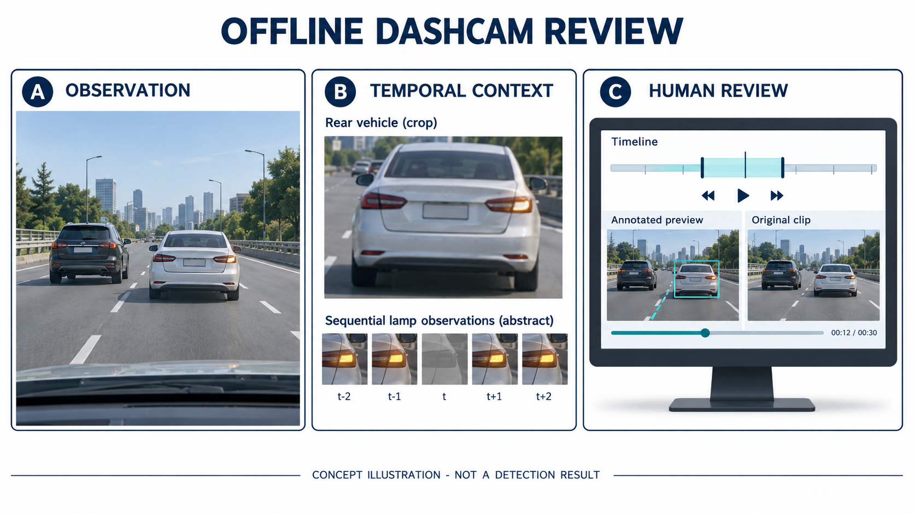
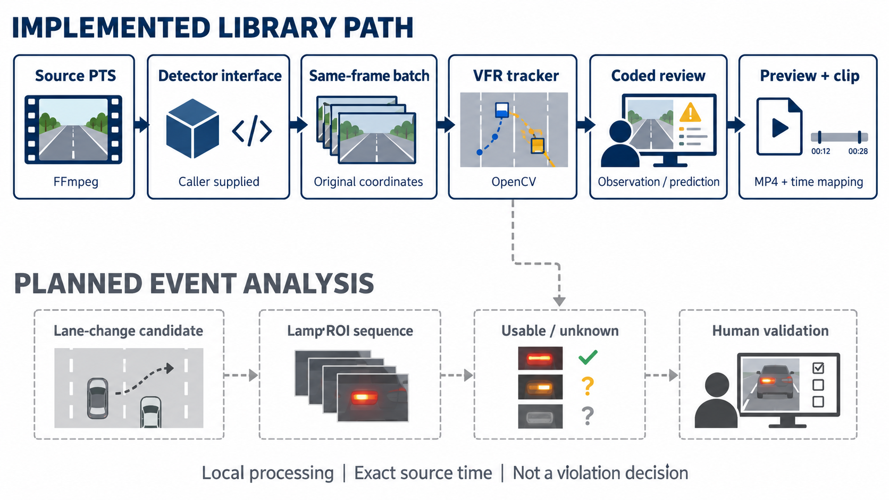
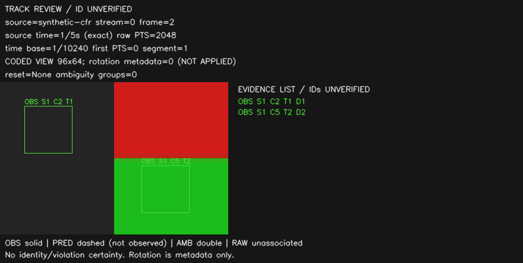
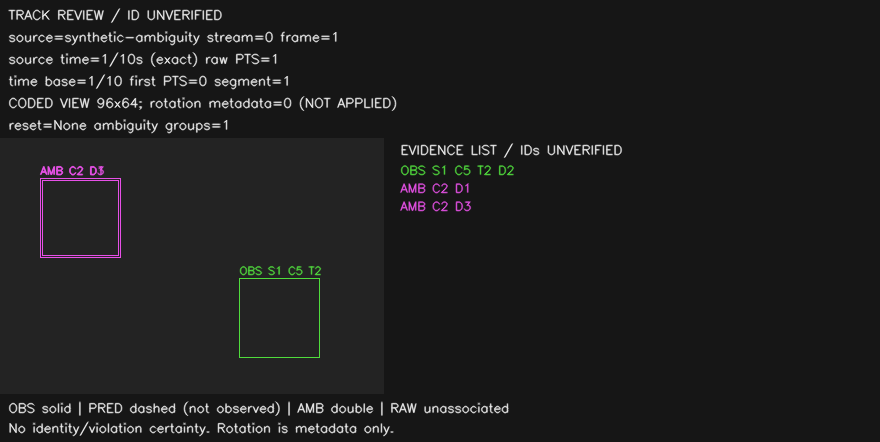
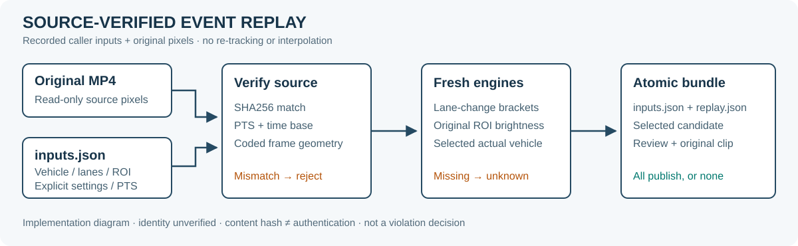
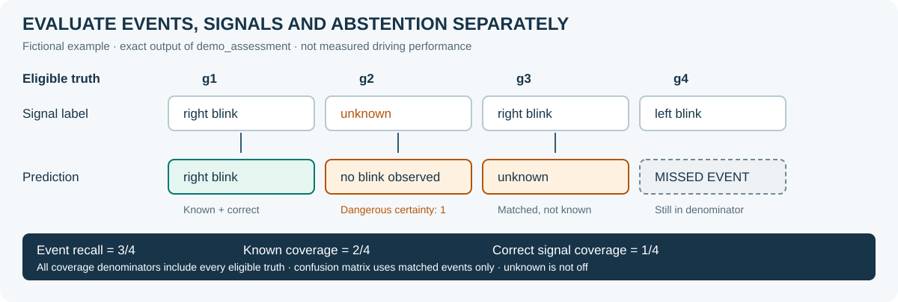
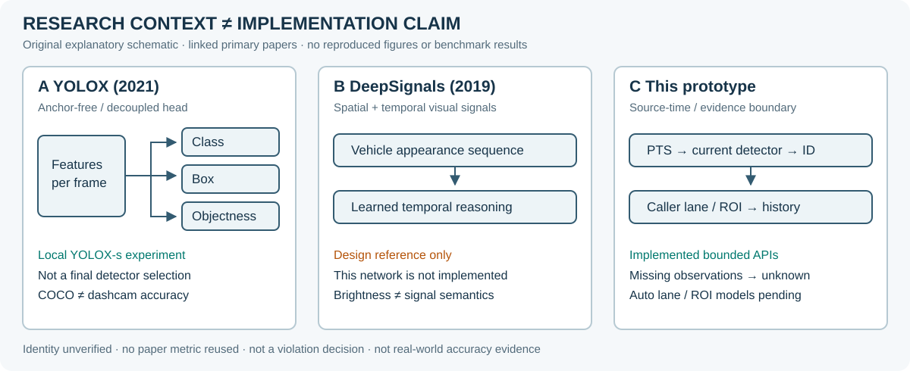
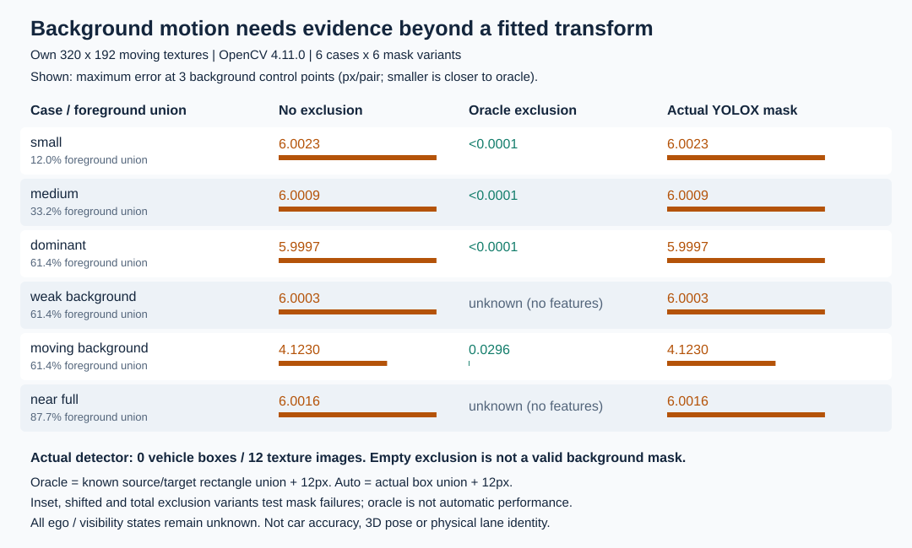

# cheating-racer-detect

### Source-Time-Preserving Dashcam Review

원본 시각과 관측 근거를 보존하는 블랙박스 분석·검토 연구 프로토타입.

## Abstract

긴 주행 영상에서 차선 변경과 방향지시등 관측을 연결해 사람이 검토할 구간을 찾습니다. 핵심은 같은 차량의 연속 관측, 정확한 원본 시간축, 관측 불능의 구분입니다. Windows 클립 CLI와 모델 독립 탐지·추적·검토 API, 입력 주입형 사건 엔진, 검증 가능한 후보 내보내기를 제공합니다. 자동 사건 판정과 실주행 정확도는 미검증입니다.

**Keywords** — dashcam · variable frame rate · multi-object tracking · temporal observation · human review



*Figure 1. AI 생성 개념도. 실제 주행 영상·탐지 결과·구현된 GUI가 아닙니다.*

## 1. Scope and Architecture

목표 흐름은 `영상 → 차량·차선 이력 → 변경 후보 → 램프 시계열 → 사람의 검토 → 클립 저장`입니다. 첫 평가 대상은 주간·맑음·전방 카메라에서 앞/대각선 앞 차량의 후면이 보이는 장면이며, 다른 조건을 영구 제외하는 것은 아닙니다.



*Figure 2. AI 생성 구조도. 점선의 자동 차선·램프 모델과 화면 아이콘은 목표를 설명하며 구현된 결과가 아닙니다.*

| 기술 | 역할 | 현재 상태 |
| --- | --- | --- |
| Python 3.13 | CLI·계약·작업 제어·원본/파생 결과 기록 | 기본 패키지의 외부 의존성 없음 |
| FFmpeg / ffprobe | 컨테이너·PTS·디코딩·H.264/AAC 클립·검토 MP4 | 합성 미디어 검증 |
| NumPy / OpenCV | 가변 dt 운동 모델·관측 연결·오버레이 | `tracking` 선택 의존성 |
| PyTorch / YOLOX-s | 차량 탐지 후보 | 로컬 실험·최종 모델 미정 |
| UFLDv2 / RVLD | 프레임별 차선·시간 문맥 연구 | 격리 실험; 공개 자동 추론 명령 없음 |
| Python 사건 엔진 | 차선 상대 위치·램프 시간 이력·후보/평가 | 명시적 입력 주입형 구현 |

미검출을 미점등으로 해석하지 않습니다. 추적 ID는 임시 식별자이며, 모델 점수·위치 예측은 위반 확률이나 실제 점멸 관측이 아닙니다.

## 2. Method

### 2.1 Source time and coordinates

정수 PTS와 time base를 유지하고 평균 FPS로 시각을 복원하지 않습니다.

```math
t_i=(PTS_i-PTS_0)\,time\_base,\qquad \Delta t_i=t_i-t_{i-1}
```

CFR/VFR·시작 offset·90도 단위 회전 metadata를 구분합니다. 분석은 coded raster를 사용하며 실제 전처리에서 적용한 회전만 좌표에 한 번 역변환합니다. 모델용 resize는 원본 픽셀의 관측 해상도를 늘리지 않습니다.

전체 시간축은 순차 검사하고 일반 경로에서 PTS/duration을 16바이트 레코드로 보관합니다. 조회·구간 선택은 immutable timeline과 이진 탐색을 사용합니다. 전체 보관량은 O(N)이며 프로세스 전체의 일정 RAM을 보장하지 않습니다. [미디어 구현](cheating_racer_detect/media.py)

### 2.2 Variable-dt tracking

운동 상태는 영상면의 `cx/cy/log(width)/log(height)`와 초당 속도입니다. 실제 Fraction dt의 전이·과정 잡음을 OpenCV KalmanFilter에 전달합니다. 현재 association은 IoU 후보 그래프의 **고유 1:1 연결**만 수락하고, 모호한 component의 이력을 종료합니다. 헝가리안·외관 ReID·물리 CTRA는 현재 backend에 포함되지 않습니다.

관측·예측·모호성을 분리하며 prediction-only를 램프/차선의 실제 차량 관측으로 사용하지 않습니다. 원본/시간/기하 변경·프레임 누락·오류/취소에서는 해당 이력을 폐기합니다. 임계치는 호출자가 명시하는 실험 정책이며 실차로 교정된 기본값이 아닙니다. [Tracker](cheating_racer_detect/tracking/tracker.py), [motion](cheating_racer_detect/tracking/motion.py)

| 실제 관측 | 위치 예측 | 중복·모호성 |
| --- | --- | --- |
|  |  |  |

*Figures 3–5. 자체 합성 입력의 실제 renderer 결과. 주행 성능이나 운전자 신원 확인의 증거가 아닙니다.*

### 2.3 Lane and lamp evidence

차선 decoder는 같은 Frame의 UFLDv2 네 head·lane slot·존재 mask를 보존합니다. 차량 하단 y의 단면은 보이는 인접 anchor 구간 안에서만 보간합니다. 현재 구간 가시성·물리 경계 ID·자차 안정/도로 맥락·후면 자세는 외부 선언이며 자동 인식되지 않습니다. 시간 문맥으로 보완한 곡선을 현재 가시성으로 승격하지 않습니다. [decoder](cheating_racer_detect/analysis/lanes.py), [LaneSectionBridge](cheating_racer_detect/events/sections.py)

램프는 같은 실제 차량의 명시 crop·좌우 부분·가시성/의미를 원본 좌표로 연결하고, whole-pixel BGR 밝기의 hysteresis와 실제 PTS의 phase/cycle·관측창을 검사합니다. 가시성/신호 의미가 외부에서 확인되지 않거나 ROI·관측창이 부족하면 unknown으로 남깁니다. 이는 밝기 패턴 분석이며 브레이크/반사광·방향지시등 의미의 자동 구분은 미구현입니다. `no_blink_observed`는 지정된 관측창의 결과이며 논리적 OFF나 위반 확정이 아닙니다. [LampObservation](cheating_racer_detect/events/lamp_observations.py), [LampEngine](cheating_racer_detect/events/lamp.py)

### 2.4 Replay, batching and verification



*Figure 6. 직접 작성한 입력·출처 재현 흐름. 모델 출력이나 외부 선언의 진위를 인증하는 도식은 아닙니다.*

입력 v1/v2/v3는 원본 해시·Frame·정책·명시 차선/램프 출처를 기록합니다. 재생은 원본 픽셀과 시각을 다시 대조하고 새 엔진으로 후보·램프 이력을 계산합니다. v2의 차선 출처와 v3의 램프 출처를 legacy의 미기록 상태와 구분하며, canonical 입력·목록/후보 해시를 보존합니다.

일괄 내보내기는 다음 순서로 처리합니다.

1. 관측 입력을 한 번 재생하고 명시한 후보 번호를 검증합니다.
2. 내부적으로 시간순 구간을 계획하고, 중첩·인접 구간을 최대 120프레임으로 묶습니다.
3. 배치 소유 readonly 픽셀 창을 재사용합니다. 기존 분석 창이 더 유리하면 큰 병합 창으로 교체하지 않습니다.
4. 사용자 선택 순서의 결과를 구성하고, 공유 자원 정리 후 전체 batch를 확정합니다.

후보 경로·`candidate_indices`·출력 목록은 사용자가 지정한 순서를 유지합니다. 원본 SHA/전체 디코딩과 각 파생 결과의 독립 검사는 생략하지 않습니다. 오류·취소·정리 실패 시 일부 후보만 성공으로 게시하지 않습니다. [배치 구현](cheating_racer_detect/events/replay.py), [픽셀 창](cheating_racer_detect/pixels.py)

후보마다 `candidate.json`, 원본 클립, 무음 coded-view `review.mp4`, 프레임별 원본↔검토 시각 매핑을 제공합니다. 원본 클립의 음성·회전과 검토 MP4의 관측 표시를 구분합니다. 후보 목록은 모든 후보·예정 맥락과 선택적 차선/램프 진단을 제공하며, 입력 사유는 실제 가시성/관측 coverage의 인증이 아닙니다.

[`verify_batch`](cheating_racer_detect/events/verify.py)는 고정 상대 참조·JSON/미디어 해시·실제 PTS/마지막 duration·회전·AAC 시각을 읽기 전용으로 재검사합니다. 선택한 원본을 제공하면 새 원본 재생 결과도 대조합니다. 목록 검증은 offline 일관성 확인과 원본 재생 검증을 구분합니다. [목록/진단 검사](cheating_racer_detect/events/listing.py)

### 2.5 Evaluation



*Figure 7. 직접 작성한 설명용 예시. 3/4·2/4·1/4는 프로젝트의 측정 정확도가 아닙니다.*

사건은 방향·시간 bracket과 명시한 일대일 대응 정책으로 평가합니다. 신호 confusion/unknown과 미탐을 포함한 coverage를 보고하며, 보류·미검출을 분모에서 빼지 않습니다. 학습/교정/평가는 주행 세션·차량 단위 분리를 고려해야 합니다. 실영상 GT와 제품 수락 수치는 미정입니다. [평가 구현](cheating_racer_detect/events/evaluate.py)

## 3. Model Research

| 후보 | 확인한 범위 | 남은 검증 |
| --- | --- | --- |
| [YOLOX-s](https://github.com/Megvii-BaseDetection/YOLOX) | COCO 탐지 후보·로컬 CPU/GPU·현재 Frame 연결 실험 | 실차 양성 탐지/ID·외관 특징의 차량 식별력 |
| [UFLDv2 ResNet-18](https://github.com/cfzd/Ultra-Fast-Lane-Detection-v2/tree/c903880678454dfd9b55a63022368db05c00bc6d) | 공식 CULane checkpoint의 제한 CPU/strict 로딩·합성 CPU/GPU·실제 디코딩 42회 CPU forward와 네 head 후처리 연결 | 실차 정확도·가시성/물리ID·차선 변경 수락 |
| [RVLD](https://github.com/dongkwonjin/RVLD/tree/4d90de138bc0122f6019cd73e452ad1955f42876) | VIL 가중치3개·U 데이터 검사, 세 CPU 생성 구조에 model-only 360텐서 strict 적용 | 구조용 forward 미구현; 전체 연산/전처리·좌표·시퀀스 검증 |
| [CLRNet](https://github.com/Turoad/CLRNet) / [CLRerNet](https://github.com/hirotomusiker/CLRerNet) | 위치 정밀화·confidence 대안의 원저자 자료 비교 | Windows/native extension·정확한 선택 파일의 조건 |
| [LaneTCA](https://github.com/Alex-1337/LaneTCA) | 시간 attention·메모리·의존성 정적 비교 | 가중치/전체 실행·실제 시간과 상태 초기화 |
| [DeepSignals](https://arxiv.org/abs/1905.01333) / [LISA](https://cvrr.ucsd.edu/vehicle-lights-dataset/) / [TLD](https://arxiv.org/abs/2409.02508) | 시공간 신호 분류·램프 위치/가시성·라벨 의미 비교 | 정확한 자료/모델 접근·권리·표본 시각·좌우/브레이크/반사/unknown 평가 |

최종 모델은 미채택입니다. 논문의 벤치마크 수치를 이 프로젝트의 성능으로 사용하지 않습니다. 다음 실험은 RVLD 실제 forward, 원본 PTS·가시성 mask가 있는 램프 특징/시계열 어댑터, 외관·운동 association 비교입니다. 추정/보간은 관측 근거와 분리하고 기존 baseline을 유지합니다.



*Figure 8. 원논문을 참고해 직접 작성한 도식. 논문 그림 복제·구현 완료·측정 성능을 뜻하지 않습니다.*

<details>
<summary>전처리·가중치·사용 조건</summary>

- **UFLDv2:** 고정 CULane config는 RGB resize 1600×533 뒤 아래 320행 crop·네 slot을 사용합니다. 원본 DALI/학습 utility 경로 대신 분리 구조에서 학습 가중치를 검사했습니다. 자체 색 패턴/단색 입력의 반응은 실차 GT가 아닙니다.
- **RVLD:** 원본은 RGB resize 640×504 뒤 상단 120행 crop·100개 y표본·상위6 SVD 계수를 사용합니다. 세 원본 checkpoint의 `weights_only=True` 로딩은 NumPy scalar 메타데이터 때문에 거부됐습니다. 허용 globals를 추가하지 않고 model 데이터만 분리해 제한 CPU 재로딩·strict 적용을 대조했습니다. U는 pickle 콜백 없이 `100×100 float32`로 변환했고, 원본 stride·유한값·표본 y54~383을 확인했습니다.
- **생성 구조:** RVLD backbone은 `weights=None`, U는 명시 입력입니다. U/pe/grid는 nonpersistent buffer이며 키·shape·dtype·BatchNorm version·적용 후 값이 일치했습니다. 생성 중 관측한 Python 파일/소켓/pretrained 호출 0회·RNG/U 보존은 전체 추론 검증과 별개입니다.
- **조건:** 코드 라이선스와 가중치/학습 데이터 조건은 별도로 확인해야 합니다. [CULane 조건](https://xingangpan.github.io/projects/CULane.html#license)은 비상업 사용·파생물/재배포를 구분합니다. [VIL-100](https://github.com/yujun0-0/MMA-Net/blob/8f95908e2814baee23c6189996062cf2d87f714a/dataset/README.md)의 CC BY-NC-SA 4.0과 RVLD root Apache-2.0 고지를 동일한 파일별 허가로 취급하지 않습니다. 전체 학습 이력·추가 파일 조건은 미확인입니다.

공식 [UFLDv2 파일](https://drive.google.com/file/d/1oEjJraFr-3lxhX_OXduAGFWalWa6Xh3W/view?usp=sharing), RVLD [가중치 ZIP](https://drive.google.com/file/d/1PjbN2uQ-7DgFJjApH1vRx81vEo_Tvn-9/view?usp=sharing)·[전처리 ZIP](https://drive.google.com/file/d/14JI2BIwJ677_rCBLGQiHvl6IF-n0LIwH/view?usp=sharing)을 사용했습니다. 자체 SHA-256은 변경 탐지용이며 발행자 인증이나 권리 보증이 아닙니다.

| 파일 | 실제 bytes | 로컬 SHA-256 |
| --- | ---: | --- |
| CULane ResNet-18 | 825,264,756 | `956616371ee758551c455d28c1c8a9732b39d7fbd85bc70b9869424a5121f967` |
| RVLD segmentation | 144,073,841 | `c488ecd893d59efc7ae7f0f823c484f6fc0c5a39c33f81e67acc4989066c4ecc` |
| RVLD coefficient | 3,209,961 | `ba0ff33f3d8a11ffcd1bf2cebd38be0582a1f454aa7ac33493572f54a20c2f1c` |
| RVLD temporal | 11,637,793 | `ba84c341be8feffb3275552fb81196807b6db9082d377989743e0137199be5a9` |
| RVLD preprocessed ZIP | 18,362,161 | `fe993a445f074740b75bbdf30463137772dc7881f837411e7b6ca4ac24ca78c1` |
| U.pickle | 40,405 | `911f3206a60548261fc834265fa443d425b6926e1dbba75994bc503015bfc169` |

RVLD 가중치 ZIP은 전체를 저장하지 않고 VIL-100의 세 payload만 선택 확보했습니다.

</details>

## 4. Reproducibility

기준 환경은 Windows · Python 3.13.13 · FFmpeg/ffprobe 9.0.2 Gyan essentials입니다. 기본 CLI에는 GPU/ML 패키지가 필요하지 않습니다.

### Install and clip

```powershell
py -3.13 -m venv .venv
.\.venv\Scripts\python.exe -m pip install .
.\.venv\Scripts\crd.exe doctor --ffmpeg-dir "D:\tools\ffmpeg\bin"
.\.venv\Scripts\crd.exe clip --input "D:\dashcam\input.mp4" --start 12.35 --end 19.8 --output "D:\review\clip-001" --ffmpeg-dir "D:\tools\ffmpeg\bin"
```

입력 경로는 자신의 파일로 바꾸고 기존 상위 폴더 안의 새 출력 이름을 지정하세요. 도구 위치는 `--ffmpeg-dir` 또는 `CRD_FFMPEG_DIR`로 전달합니다. 새 PC 구성에는 [bootstrap.ps1](scripts/bootstrap.ps1)의 `-DownloadTools`를 사용할 수 있으며 고정 도구 해시를 확인합니다.

검토 렌더링에는 `python -m pip install ".[tracking]"`으로 NumPy/OpenCV를 준비합니다. PyTorch·모델은 기본/선택 패키지 설치에 포함되지 않습니다.

### Recorded-input workflow

아래는 자동 탐지 명령이 아니라 **기록된 관측 입력**을 처리하는 명령입니다.

```powershell
crd events list --input "D:\dashcam\input.mp4" --inputs "D:\recording\inputs.json" --output "D:\review\catalog-001" --lane-diagnostics --lamp-diagnostics --ffmpeg-dir "D:\tools\ffmpeg\bin"
crd events replay --input "D:\dashcam\input.mp4" --inputs "D:\review\catalog-001\inputs.json" --catalog "D:\review\catalog-001\catalog.json" --candidate-indices 1 0 --output "D:\review\batch-001" --ffmpeg-dir "D:\tools\ffmpeg\bin"
crd events verify --bundle "D:\review\batch-001" --input "D:\dashcam\input.mp4" --ffmpeg-dir "D:\tools\ffmpeg\bin"
crd events verify-list --listing "D:\review\catalog-001" --require-diagnostics lane lamp
crd events evaluate --labels "D:\evaluation\labels.json"
```

`crd`가 PATH에 없으면 `.\.venv\Scripts\crd.exe`를 사용하세요. 단일 후보는 `--candidate-index 0`입니다. 설치 CLI는 성공 0/JSON stdout, 오류 2/JSON stderr, 취소 130을 반환합니다. 기존 `scripts.*` 명령의 오류 1/JSON stdout 계약도 유지합니다.

API 진입점: [탐지 연결](cheating_racer_detect/analysis/bridge.py), [관측 입력](cheating_racer_detect/events/inputs.py), [후보 목록](cheating_racer_detect/events/catalog.py), [차선/램프 진단](cheating_racer_detect/events/diagnostics.py).

### Synthetic demos and diagnostics

다음 scripts.*와 테스트 명령은 소스 체크아웃에서 실행합니다.

```powershell
python -m scripts.demo_batch_replay --output "D:\review\synthetic-batch"
python -m scripts.demo_lane_replay --output "D:\review\synthetic-lanes"
python -m scripts.demo_lamp_replay --output "D:\review\synthetic-lamps"
python -m scripts.benchmark_batch --seconds 60 --window tail --order reverse
python -m scripts.benchmark_scaling --seconds 300 --window tail
python -m unittest discover -s tests
```

데모는 자체 생성 영상과 scripted 차량·차선·ROI·가시성 선언을 사용합니다. 자동 모델 출력이나 실차 정확도 자료가 아닙니다. [batch 비용 진단](scripts/benchmark_batch.py)은 도구별 호출/시간·SHA 논리 읽기량·raw payload·자체 RAM/표본 임시 용량과 기존 reason family를 보고합니다. 원인 미확인을 조명 변화나 가림으로 단정하지 않습니다.

배포 검사는 [check_install.py](scripts/check_install.py)에서 sdist→wheel·파일/RECORD·새 환경·외부 폴더의 CLI·기본 noML/선택 의존성을 대조합니다. 기존 uv·setuptools≥77·FFmpeg와 선택 설치용 offline cache를 사용하며 실제 검증 자원은 종료 시 정리합니다.

## 5. Experimental Validation

| 검증 축 | 확인한 범위 | 남은 범위 |
| --- | --- | --- |
| 시간·미디어 | 자체 CFR/VFR·offset·회전·AAC·긴 GOP·실패/취소/복구·원본 보존 | 실제 블랙박스 장시간/분할 파일 |
| 추적·사건 | 수치 oracle·native OpenCV·관측/예측/모호성·주입 후보·unknown·평가 분모 | 실차 ID/탐지/자동 차선·램프 의미 |
| batch | 7개 미디어 profile의 독립 coded BGR/원본 PTS·역순 결과·저장 재검사·정리 실패와 새 실행 | keyframe seek·실차/HD 처리 성능 |
| 모델 연구 | UFLDv2 학습 CPU/GPU·Frame 연결, RVLD 데이터/생성 구조 strict | RVLD forward/시퀀스·최종 모델 채택 |
| 패키지 | wheel/sdist 경계·Windows clean 설치·noML/선택 CLI | 다른 OS·공개 패키지 배포 |

자체 96×64/10fps의 두 후보를 새 프로세스로 비교한 결과입니다. 5초 head와 60초 tail에서 후보·신호·원본 ordinal/PTS 매핑은 같았습니다.

| 배치 비용 | 이전 | 공유 윈도우 |
| --- | ---: | ---: |
| 원본 raw 픽셀 디코딩 | 2회 | 1회 |
| 생성 raw payload | 1,069,056bytes | 811,008bytes |
| 원본 SHA-256 읽기 | 16회 | 16회 |
| 원본 전체 디코딩 검사 | 2회 | 2회 |
| 파생 전체 디코딩 검사 | 4회 | 4회 |

이는 해당 합성 구간의 중복 픽셀 작업 감소입니다. 전체 wall time의 유의한 개선은 확인하지 않았습니다. 원본 전체 읽기·검사/인코딩은 남아 있고, hash bytes는 물리 디스크 I/O가 아닙니다. 자체 RAM은 FFmpeg 자식/GPU를 제외하며 표본 임시 용량은 순간 최대치를 놓칠 수 있습니다.



*Figure 9. 자체 합성 texture pair의 제외 영역 비교. 정답 mask는 자동 인식이 아니며 기존 YOLOX-s는 12회 입력에서 차량 0개를 검출했습니다. 전경 이동을 잘 맞춘 수치도 자차 이동·현재 가시성의 인증이 아닙니다.*

## 6. Limits and Next Steps

| 항목 | 지원 범위 |
| --- | --- |
| 미디어 | 단일 로컬 MP4·H.264 8-bit 4:2:0 SDR 1개·AAC 0~1개 |
| 시간·회전 | 첫 원본 비디오 PTS 기준 `[start,end)`·CFR/VFR·시작 offset·90도 단위 회전 |
| 분석/검토 | 원본 축≤1024·프레임당 탐지≤64·선택 구간≤120프레임·제한된 time base |
| 입력 재생 | 한 차량·JSON≤1 MiB·입력/디코딩 구간≤120프레임 |
| batch | 명시 후보 1~120개·직렬 처리·각 창≤120프레임·전체 확정 또는 전체 실패 |
| 시간축·픽셀 | 전체 O(N) 시간축·단일 소유 픽셀 창; 교체 중 기존+신규 두 창의 임시 공간 필요 |
| 평가 | GT/예측 각≤64·명시 대응/시간 정책·unknown/미탐 포함 |
| 복구 | 원본/기존 결과 덮어쓰기 금지·오류/취소 시 소유 자원 정리 |

HEVC·HDR·다중 비디오/자막/데이터 트랙·분할 파일 결합·네트워크/재분석 지점·상위 경로(`..`)는 지원하지 않습니다. 마지막 포함 프레임의 표시 길이는 요청 끝을 넘을 수 있습니다.

현재 입력 주입형 규칙은 자동 차량 자세·자차 이동·차선 가시성/물리 ID·램프 위치/좌우/의미 인식을 대신하지 않습니다. 다음은 실제 RVLD 계산 경로와 timestamped 램프 특징·외관 association의 비교입니다. 현재 가시성·점멸 증거를 예측/생성 픽셀로 채우지 않습니다. 실영상 정밀도/재현율·unknown coverage·연속 파일·사용자 검토 효과와 최종 모델/전체 권리는 미검증입니다. 자동 신고·법적 위반 확정을 제공하지 않으며 프로젝트 라이선스는 미정입니다.

## References

1. Ge et al. (2021). [YOLOX](https://arxiv.org/abs/2107.08430). 탐지 후보.
2. Frossard et al. (2019). [DeepSignals](https://arxiv.org/abs/1905.01333). 공간·시간 신호 추론.
3. Qin et al. (2022). [UFLDv2](https://arxiv.org/abs/2206.07389). hybrid anchor 차선 표현.
4. Jin et al. (2023). [Recursive Video Lane Detection](https://openaccess.thecvf.com/content/ICCV2023/html/Jin_Recursive_Video_Lane_Detection_ICCV_2023_paper.html). 시간 문맥 차선 연구.
5. Zheng et al. (2022). [CLRNet](https://arxiv.org/abs/2203.10350), Honda & Uchida (2024). [CLRerNet](https://arxiv.org/abs/2305.08366). refinement·confidence 대안.
6. Gopalkrishnan et al. (2023). [Vehicle Light Localization](https://arxiv.org/abs/2307.14571v2), Greer et al. (2023). [Patterns of Vehicle Lights](https://arxiv.org/abs/2307.14521). 위치·가시성 표현.
7. Chai et al. (2024). [TLD](https://arxiv.org/abs/2409.02508). 차량 신호 분류 자료.
8. [OpenCV KalmanFilter](https://docs.opencv.org/4.11.0/dd/d6a/classcv_1_1KalmanFilter.html), [FFmpeg](https://ffmpeg.org/ffmpeg.html). 수치·미디어 API.
